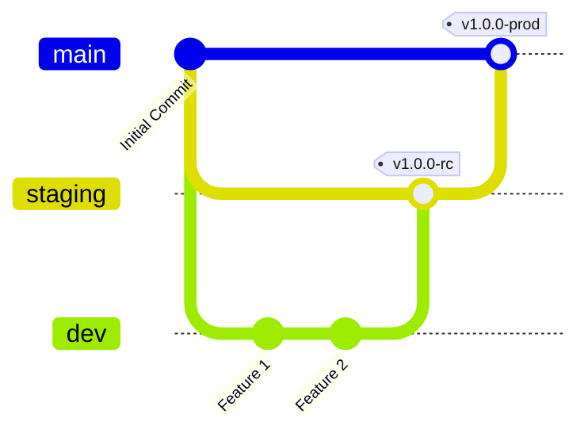
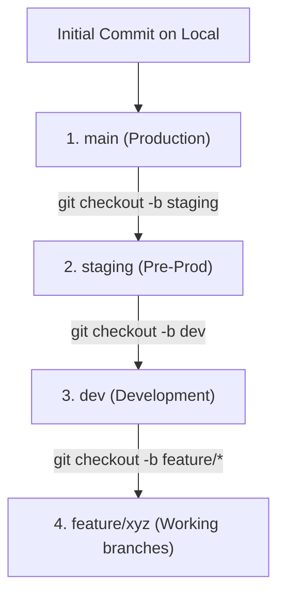
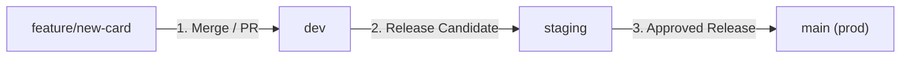

# 🌿 Git Version Control & Multi-Environment Branching Guide
# دليل إدارة الإصدارات وفروع بيئات العمل (Dev - Staging - Prod)

A complete, step-by-step guide to setting up Git version control, verifying your GitHub remote connection, and organizing your repository into a **3-tier environment branching strategy** (`dev`, `staging`, `main/prod`).

---

## 📌 Architecture: 3-Tier Environment Strategy



| Branch (الفرع) | Environment (البيئة) | Purpose & Usage (الاستخدام والهدف) |
| :--- | :--- | :--- |
| **`main`** | **Production (Prod)** | الكود النهائي المستقر والمنشور للمستخدمين على السيرفر الحي. (Live, battle-tested code). |
| **`staging`** | **Staging (Pre-Prod)** | بيئة تجريبية مطابقة للإنتاج لاختبار التحديثات والتأكد منها قبل النشر الفعلي. (QA / Pre-release testing). |
| **`dev`** | **Development (Dev)** | الفرع التجميعي لجميع الميزات الجديدة والتطوير اليومي. (Active integration & feature merging). |

---

## 🚀 Step 1: Start Version Control (Local Initialization)
### الخطوة الأولى: بدء المستودع المحلي على جهازك

Open your terminal (PowerShell, Command Prompt, or Git Bash) inside the project folder:
```bash
cd "c:\Users\Hamdy\OneDrive\Documents\Projects\Invitation Company\invitation"
```

### 1. Set your Git Identity (Only once on your machine)
```bash
git config --global user.name "Your Name"
git config --global user.email "your.email@example.com"
```

### 2. Initialize Git Repository
```bash
git init
```

### 3. Verify `.gitignore`
Make sure sensitive files and build artifacts are ignored. Your `.gitignore` should at least include:
```text
node_modules/
.env
.env.local
dist/
build/
.DS_Store
Thumbs.db
```

### 4. Create your Initial Commit
```bash
# Add all files to the staging area
git add .

# Commit files
git commit -m "feat: initial commit for invitation project"
```

---

## 🔍 Step 2: Check Connection to Remote GitHub Repo
### الخطوة الثانية: معرفة حالة الربط مع مستودع GitHub

Run this command:
```bash
git remote -v
```

### How to interpret the output:

#### Case A: Blank / No output (Not connected yet)
You are not yet linked to any remote GitHub repository.

1. Go to [GitHub.com](https://github.com/) and create a **New Repository** (do not initialize with README or `.gitignore`).
2. Copy the repository URL (HTTPS or SSH).
3. Connect your local folder to GitHub:
   ```bash
   git remote add origin https://github.com/<YOUR-USERNAME>/<YOUR-REPO-NAME>.git
   ```

#### Case B: URLs are displayed (Connected)
```text
origin  https://github.com/username/invitation.git (fetch)
origin  https://github.com/username/invitation.git (push)
```
You are successfully linked to `origin`.

### Testing Your Authentication:
To confirm your computer has permission to read and write to GitHub:
* **HTTPS**:
  ```bash
  git ls-remote
  ```
  *(If prompted, sign in via browser or GitHub Personal Access Token)*
* **SSH**:
  ```bash
  ssh -T git@github.com
  ```

> [!TIP]
> If you need to update an existing remote URL:
> ```bash
> git remote set-url origin https://github.com/<YOUR-USERNAME>/<YOUR-REPO-NAME>.git
> ```

---

## 🌿 Step 3: Create the 3 Environment Branches (`main`, `staging`, `dev`)
### الخطوة الثالثة: إنشاء فروع بيئات العمل الثلاث ورفعها إلى GitHub



### 1. Set default branch to `main` and push to GitHub
```bash
# Ensure current branch is named 'main'
git branch -M main

# Push 'main' to GitHub and set upstream tracking
git push -u origin main
```

### 2. Create and push `staging`
```bash
# Create and switch to staging from main
git checkout -b staging

# Push staging to GitHub
git push -u origin staging
```

### 3. Create and push `dev`
```bash
# Create and switch to dev from staging
git checkout -b dev

# Push dev to GitHub
git push -u origin dev
```

### 4. Verify all branches
```bash
# List all local branches
git branch

# List all local and remote branches
git branch -a
```
Expected output:
```text
* dev
  staging
  main
  remotes/origin/dev
  remotes/origin/staging
  remotes/origin/main
```

---

## 🔄 Step 4: Daily Development & Promotion Workflow
### الخطوة الرابعة: دورة العمل اليومية وترقية الكود بين البيئات



### 1. Working on a New Feature or Fix
Never write code directly on `main` or `staging`. Always branch off `dev`:
```bash
# 1. Switch to dev and get latest updates
git checkout dev
git pull origin dev

# 2. Create your feature branch
git checkout -b feature/audio-player

# 3. Make changes, then commit
git add .
git commit -m "feat: add background audio player"
```

### 2. Merging Feature into `dev`
```bash
git checkout dev
git pull origin dev
git merge feature/audio-player
git push origin dev

# (Optional) Delete the local feature branch after merging
git branch -d feature/audio-player
```

### 3. Promoting `dev` to `staging` (Testing phase)
When a batch of features is ready for testing:
```bash
git checkout staging
git pull origin staging
git merge dev
git push origin staging
```

### 4. Promoting `staging` to `main` (Production release)
Once staging has been verified and approved:
```bash
git checkout main
git pull origin main
git merge staging
git push origin main
```

---

## 🛠️ Step 5: Essential Git Commands Cheat Sheet
### جدول أهم أوامر Git للاستخدام اليومي

| Command | Action |
| :--- | :--- |
| `git status` | معرفة حالة الملفات والفرع الحالي (Check modified files) |
| `git checkout <branch>` or `git switch <branch>` | الانتقال إلى فرع آخر (Switch branch) |
| `git checkout -b <new-branch>` | إنشاء فرع جديد والانتقال إليه مباشرة (Create & switch) |
| `git pull origin <branch>` | سحب آخر التحديثات من GitHub (Download remote changes) |
| `git push origin <branch>` | رفع التعديلات المحفوظة إلى GitHub (Upload changes) |
| `git log --oneline -n 10` | عرض آخر 10 عمليات حفظ بشكل مختصر (History log) |
| `git diff` | مراجعة الفروقات بين التعديلات والكود السابق (View file changes) |
| `git remote -v` | التحقق من روابط المستودع على GitHub (Verify remotes) |

---

## ⚠️ Troubleshooting Tips (حلول المشاكل الشائعة)

### 1. "fatal: not a git repository"
You are either in the wrong folder or haven't run `git init` yet. Check your current path with `pwd` (or `Get-Location` in PowerShell) and run `git init`.

### 2. "Updates were rejected because the remote contains work that you do not have locally"
Someone made changes on GitHub directly (e.g. edited a file or created a README):
```bash
git pull origin <branch-name> --rebase
git push origin <branch-name>
```

### 3. Accidentally committed the wrong file
```bash
# Unstage file without losing your edits
git restore --staged <filename>
```
