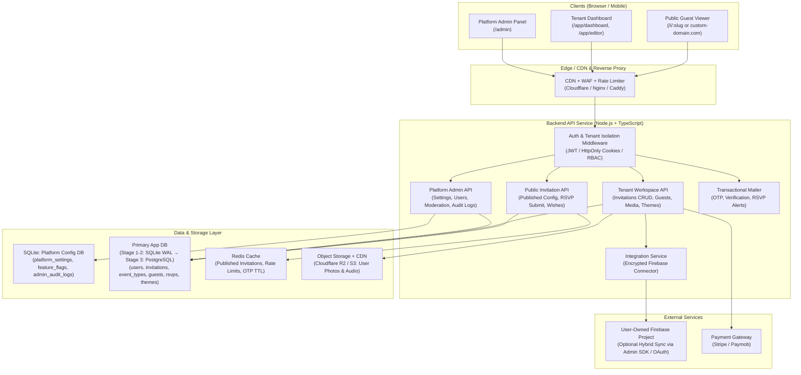
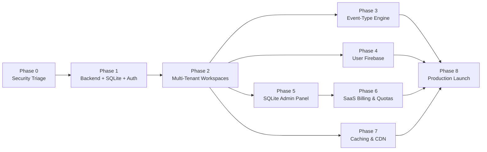

# UpgradPlan.md — Project-Wide Assessment & Multi-Tenant SaaS Upgrade Roadmap

**Assessment Date:** November 17, 2026  
**Repository:** `https://github.com/hamdyKouta1/invitation` (Branch: `main`, Head: `0d08caf`)  
**Assessment Scope:** Full-stack source code, configuration, build/deployment pipeline, security posture, and product architecture review (Read-only assessment — zero source code or configuration modifications performed).

---

## 1. Executive Summary

The current project is a **single-event, client-only React 19 + Vite 8 wedding invitation application** built for a specific couple (Hamdy & Rodina), deployed statically to GitHub Pages, with optional Google Cloud Firestore synchronization and a browser-based admin portal (`AdminPortal.jsx` / `AdminApp.jsx`).

While the application delivers a polished luxury UI—featuring a 3D animated envelope, 5 rich visual themes (`default`, `elegant-luxury`, `minimalist-modern`, `romantic-floral`, `royal-classic`), Arabic RTL / English LTR bilingual support, and a dynamic section ordering/custom-section engine—it is **architecturally unsuitable for a multi-tenant SaaS platform in its current state**.

### Key Assessment Findings
1. **Critical Security Deficiencies:**
   - **Client-Side Authentication Bypass:** Admin credentials (`VITE_ADMIN_EMAIL`, `VITE_ADMIN_PASSWORD`) and legacy fallback credentials (`admin` / `wedding2026` / `123456`) are compiled directly into the public client-side JavaScript bundle (`src/components/Admin/AdminPortal.jsx#L66-L67`, `src/admin/AdminApp.jsx#L60-L61`, `L168-L169`).
   - **Client-Side 2FA/OTP:** OTP generation, storage (`sessionStorage`), and verification occur entirely in the user's browser (`src/services/mail/otpService.js#L37-L168`), allowing trivial bypass via DevTools.
   - **Unauthenticated Database Writes:** The documented Firestore security rules (`FIREBASE_INTEGRATION_GUIDE.md#L60-L78`) allow public `allow write: if true` on `config/{document}`, `gallery/{document}`, and `allow update, delete: if true` on `rsvps/{document}`.
2. **Zero Multi-Tenancy or Backend Layer:**
   - There is no backend server, API gateway, or relational database. All data lives in a single global Firestore document (`config/wedding`) and flat root collections (`rsvps`, `gallery`, `wishlist`).
   - User accounts, tenant isolation, slug-based routing, and invitation lifecycle management do not exist.
3. **Wedding-Specific Hardcoding:**
   - Couple entities (`groom`, `bride`), family titles, personal names, GitHub Pages URLs (`https://hamdyKouta1.github.io/invitation/`), and wedding-only terminology are deeply embedded in `index.html`, `src/config/weddingConfig.js`, `src/utils/configManager.js`, `src/i18n/*.json`, and UI components.
4. **Configuration & Integration Coupling:**
   - Firebase is initialized once as a global singleton (`src/services/firebase/config.js#L14-L30`) from build-time `VITE_*` environment variables.
   - Admin configuration relies on build-time `.env` variables, `localStorage` overrides, and a single Firestore document rather than a persistent, server-managed **SQLite** administrative database.

### Strategic Recommendation
Transform the application in **8 structured phases** (Phase 0 through Phase 8), beginning with immediate security remediation (Phase 0), introducing a lightweight Node.js/TypeScript backend + **SQLite** persistence layer (Phase 1), establishing multi-tenant user accounts and invitation workspaces (Phase 2), generalizing the wedding schema into a polymorphic **Event-Type & Dynamic Section Engine** (Phase 3), and safely adding user-owned Firebase integrations (Phase 4), SQLite-backed platform administration (Phase 5), SaaS monetization (Phase 6), caching/CDN scalability (Phase 7), and production launch readiness (Phase 8).

---

## 2. Current Project Overview

| Attribute | Current Implementation |
|---|---|
| **Product Type** | Single-couple interactive digital wedding invitation |
| **Frontend Stack** | React `19.2.8`, Vite `8.2.0`, Framer Motion `13.1.1`, Lucide React `1.33.0` |
| **Form & Validation** | React Hook Form `7.85.0`, Zod `3.25.76`, `@hookform/resolvers` `5.9.1` |
| **Internationalization** | `i18next` `26.4.0`, `react-i18next` `17.0.12` (Arabic `ar` RTL / English `en` LTR) |
| **Backend / API** | **None** (100% client-side SPA; optional external `smtp-proxy` documented in `MAIL_SETUP.md` but not present in repo) |
| **Database / Storage** | Google Cloud Firestore (`firebase` `12.18.0`) + browser `localStorage` fallback (`mockService.js`) |
| **Linting / Tooling** | `oxlint` `1.75.0` (`.oxlintrc.json`), no test runner installed |
| **Hosting / Deployment** | Static hosting via `gh-pages` (`npm run deploy` pushes `dist/` to `origin/gh-pages`) |
| **Entry Points** | `index.html` → `src/main.jsx` → `src/App.jsx` (and `admin.html` → `src/admin/adminMain.jsx` → `src/admin/AdminApp.jsx`) |

---

## 3. Existing Architecture Assessment

### 3.1 Application Architecture
The codebase is a purely client-side Single Page Application (SPA) with two HTML entry points:
1. **`index.html` (`src/main.jsx` → `src/App.jsx`):** Renders the public invitation behind an interactive `Envelope` gate. Also conditionally renders `AdminPortal.jsx` as an overlay when the URL hash matches `#admin-secret`, `#admin`, `#${VITE_ADMIN_SECRET_ENDPOINT}`, or `?portal=admin` (`src/App.jsx#L114-L120`).
2. **`admin.html` (`src/admin/adminMain.jsx` → `src/admin/AdminApp.jsx`):** A standalone admin dashboard entry point. **Discrepancy:** `vite.config.js` does not configure `build.rollupOptions.input` for multi-page builds, so `npm run build` only bundles `index.html` and omits `admin.html` from `dist/` (verified in `origin/gh-pages` tree listing).

### 3.2 State & Configuration Flow
- **Context:** `WeddingConfigContext.jsx` holds the active invitation configuration in React state, initialized synchronously via `getActiveConfig()` (`src/utils/configManager.js#L247-L263`).
- **Sync Priority:** On mount, `AppContent` calls `syncConfigWithFirestore()` (`src/App.jsx#L128-L130`), and `WeddingConfigProvider` subscribes to `doc(db, 'config', 'wedding')` via `onSnapshot` (`src/services/firebase/firestore.js#L295-L314`).
- **Service Abstraction:** `src/services/index.js` dynamically imports either `./firebase/firestore.js` or `./mock/mockService.js` based on the build-time constant `import.meta.env.VITE_FIREBASE_ENABLED === 'true'` (`src/services/index.js#L9`).

### 3.3 Documented vs. Actual Behavior Discrepancies
1. **Standalone `admin.html` in Production:** Documented in `PROJECT_GUIDE.md#L396`, but excluded from Vite's production `dist/` output because `vite.config.js` lacks multi-page Rollup input configuration.
2. **`AdminApp.jsx` vs. `AdminPortal.jsx` Divergence:** `AdminApp.jsx` (1,848 lines) uses single-factor username/password login with hardcoded fallbacks (`'hamdy'`, `'admin'`, `'123456'`, `'wedding2026'`, lines 168–169), supports local `FileReader` base64 image uploads (lines 263–280), and hardcodes `http://localhost:5175` (line 568). `AdminPortal.jsx` (2,020 lines) uses 2FA email + OTP, omits local file upload, and adds `handleUploadDefaultToFirestore`. Both duplicate ~1,500 lines of identical JSX and state logic.
3. **2FA Security Claims:** `README.md` and `PROJECT_GUIDE.md` describe the admin portal as secured with "2-Factor Authentication", whereas `otpService.js` generates and verifies the OTP entirely in the browser's `sessionStorage`.
4. **`smtp-proxy` Directory:** `MAIL_SETUP.md#L35-L60` instructs users to `cd smtp-proxy`, which does not exist in the repository.
5. **Firebase Storage:** `src/services/firebase/config.js#L12,L29` initializes `getStorage(app)`, but `storage` is never imported or used anywhere; gallery photos are external URLs, Google Drive links, or base64 data URIs.
6. **Wishlist Firestore vs. Config Mismatch:** `firestore.js#L316-L344` reads/updates a top-level `wishlist` Firestore collection, while `AdminPortal.jsx` and `AdminApp.jsx` store wishlist items inside `config/wedding` (`wishlist.items`), and `Wishlist.jsx#L127-L131` short-circuits to `wishlistConfig.items` without calling Firestore when `wishlistConfig.items` is non-empty.
7. **GA4 Analytics (`useAnalytics.js`):** `useAnalytics.js#L10` checks `weddingConfig.analytics?.enabled` from the static file rather than live context, and no `gtag.js` script is loaded in `index.html`.
8. **Unused `date-fns` / `date-fns-tz`:** Installed in `package.json#L15-L16` and referenced in `useCountdown.js` comments, but `useCountdown.js` uses native `Date.getTime()` and `Date.now()`.

---

## 4. Current Features & Capabilities

| Feature | Implementation Files | Current Capability | Multi-Tenant SaaS Readiness |
|---|---|---|---|
| **3D Envelope & Wax Seal** | `Envelope.jsx`, `ThemeVisuals.jsx` | Animated flap, card reveal, theme-specific seal & colors | Reusable; requires dynamic event title & cover image |
| **5 Visual Themes** | `themesConfig.js`, `themes.css`, `ThemeVisuals.jsx`, `FloralCornerSVG.jsx`, `OrnamentDivider.jsx` | 5 cohesive themes with CSS variables, SVG crests, ambient particles, live preview banner | Reusable foundation; needs decoupling from wedding-only copy |
| **Dynamic Section Engine** | `App.jsx`, `configManager.js`, `DynamicSectionsEditor.jsx`, `CustomSection.jsx` | Reorder, toggle visibility, override headings, add custom bilingual sections | Strong foundation for generic event builder |
| **Bilingual i18n (AR/EN)** | `src/i18n/index.js`, `ar.json`, `en.json`, `rtl.css` | Full RTL/LTR switching with `localStorage` persistence | Needs namespace separation (platform UI vs. invitation labels) |
| **Countdown Timer** | `Countdown.jsx`, `useCountdown.js` | Live days/hours/minutes/seconds with customizable completion quote | Reusable for any dated event |
| **Venue & Map** | `Venue.jsx` | Address display, Google Maps link, embedded iframe | Reusable; needs sanitization of map URLs |
| **Photo Gallery & Lightbox** | `Gallery.jsx` | Masonry/grid layouts, Google Drive URL transform, touch-swipe lightbox | Needs per-invitation scoping and real object storage |
| **RSVP & Wishes Wall** | `RSVP.jsx`, `WishesWall.jsx` | Zod-validated form, `localStorage` duplicate guard, live wishes feed | Needs per-invitation DB scoping & server-side spam protection |
| **Wishlist & Gifting** | `Wishlist.jsx` | Instapay, IBAN copy, external registry link, item reservation | Needs atomic server/transaction reservation & event-type gating |
| **Admin Portal** | `AdminPortal.jsx`, `AdminApp.jsx`, `ThemeManager.jsx` | Guest CRUD, CSV/JSON export, KPIs, Gallery CRUD, Live Config Editor | Must be replaced with authenticated multi-tenant workspace + platform admin |

---

## 5. Technical Weaknesses

| ID | Category | Current Implementation | Identified Weakness | Business / Technical Impact | Severity | Recommended Solution | Dependencies | Priority |
|---|---|---|---|---|---|---|---|---|
| **ARC-001** | Architecture | 100% client-side SPA (`src/App.jsx`, `vite.config.js`) | No backend server or API layer; all business logic, auth, and DB access happen in the browser | Impossible to enforce tenant isolation, protect secrets, process payments, or run server-side SQLite | **Critical** | Introduce a lightweight Node.js (Express/Fastify) backend API with REST/JSON endpoints | None | P0 |
| **ARC-002** | Code Quality | `AdminApp.jsx` (1,848 lines) & `AdminPortal.jsx` (2,020 lines) | Massive code duplication with diverging auth and feature sets; monolithic components | High maintenance cost, bug drift, and inconsistent security behavior | **High** | Consolidate into a single modular Admin/Workspace UI backed by API services | ARC-001 | P1 |
| **ARC-003** | Build Config | `vite.config.js#L5` | Hardcoded `base: '/invitation/'` in production and missing `admin.html` Rollup input | Breaks root-domain SaaS hosting and custom domains; `admin.html` missing from `dist/` | **High** | Serve `/` at root in SaaS mode; configure React Router (`BrowserRouter`) for multi-route SPA | ARC-001 | P1 |
| **ARC-004** | State / Data | `RSVP.jsx#L34-L36`, `firestore.js#L41-L43` | Duplicate RSVP prevention uses `localStorage.getItem('wedding_rsvp_submitted')` | Shared across all invitations on the domain; trivially bypassed by incognito/clearing storage | **Medium** | Scope client guard by `invitationId` and enforce server-side deduplication/rate-limiting | ARC-001 | P2 |
| **ARC-005** | Data Model | `Wishlist.jsx#L127-L146` vs `firestore.js#L316-L344` | Dual conflicting storage for wishlist items (`config/wedding` vs `wishlist` collection) | Guest reservations in `Wishlist.jsx` may silently fail or desync from Admin UI | **Medium** | Unify wishlist/registry items into a single normalized relational/API resource | ARC-001 | P2 |
| **ARC-006** | Validation / UX | `Wishlist.jsx#L149` | Uses `window.prompt()` for guest name on gift reservation | Poor mobile UX, no validation, cannot style or localize cleanly | **Low** | Replace with an accessible React modal dialog with Zod validation | None | P3 |
| **ARC-007** | Dependencies | `package.json`, `useAnalytics.js`, `useCountdown.js` | Unused `date-fns`/`date-fns-tz`; `useAnalytics` reads static `weddingConfig` instead of context; `gtag.js` missing | Dead bundle weight and non-functional analytics | **Low** | Remove unused packages or wire `date-fns-tz` properly; inject GA4 dynamically from config | None | P3 |

---

## 6. Scalability & Multi-Tenant Assessment

### 6.1 Current Multi-Tenancy Gaps
Currently, the platform is **single-tenant by design**:
- **Single Config Document:** `firestore.js#L271,L286,L297` hardcodes `doc(db, 'config', 'wedding')`. Every visitor and admin reads and overwrites the exact same document.
- **Unscoped Collections:** `rsvps` and `gallery` are root-level collections. Although `rsvps` writes an `invitationId` field (`firestore.js#L58`), `getWishes()` (`L73-L77`), `getGuests()` (`L128`), and `clearAllGuests()` (`L195`) **never filter by `invitationId`**.
- **Global LocalStorage Keys:** `wedding_config_override`, `wedding_active_theme`, `wedding_rsvps`, `wedding_gallery_images`, `wedding_rsvp_submitted`, and `wedding_lang` are global keys. Visiting Invitation B overwrites Invitation A's cached config in the same browser.
- **No Routing:** There is no URL router (`react-router-dom` is not installed). The app cannot resolve `/i/:slug` or custom domains.

### 6.2 User Isolation Requirements
To achieve `Platform → Users → Invitations → Event Data`:
1. **Tenant/User Boundary:** Every authenticated user receives a unique `user_id` (UUID).
2. **Invitation Ownership:** Every `invitation` record has `owner_user_id` and a unique `slug` (plus optional verified `custom_domain`).
3. **Resource Scoping:** Every `guest`, `rsvp`, `wish`, `gallery_item`, `wishlist_item`, `theme_override`, and `integration_config` must carry `invitation_id` (and `owner_user_id` or join through `invitations`).
4. **API Authorization Middleware:** Every private endpoint (`/api/invitations/:id/*`) must verify `invitation.owner_user_id === req.user.id` (or `req.user.role === 'platform_admin'`) before reading or mutating data.
5. **Public Read/Write Scoping:** Public endpoints (`/api/public/invitations/:slug`, `/api/public/invitations/:slug/rsvp`) must only return published invitations (`status === 'published'`) and must **never** expose private guest phone numbers, admin emails, or integration secrets.

### 6.3 Realistic Scalability Analysis & Bottlenecks

| Growth Stage | Scale Target | Current Bottlenecks | Realistic Strategy & Architecture Changes |
|---|---|---|---|
| **Stage 1: MVP / Early Launch** | 10–200 users, 500 invitations, <10k RSVPs | Single global Firestore doc, no backend, no image optimization | Node.js API + **SQLite (WAL mode)** for platform/app data + local/S3-compatible object storage (e.g., Cloudflare R2) for media |
| **Stage 2: Growth** | 500–2,000 users, 5k–10k invitations, 100k+ RSVPs | SQLite single-writer lock under concurrent RSVP spikes; unindexed JSON queries; no caching | **Redis** caching for published invitation payloads (`GET /api/public/:slug`); CDN (Cloudflare) in front of static assets & media; async job queue for emails/image resizing |
| **Stage 3: Scale** | 5,000+ users, 25k+ invitations, viral event traffic (1,000+ req/min) | SQLite write contention & single-node vertical ceiling; multi-instance horizontal scaling impossible with local SQLite file | Migrate primary multi-tenant transactional DB from SQLite to **PostgreSQL** (managed, with read replicas & connection pooling); keep stateless API containers behind load balancer |

> **Capacity Note:** We explicitly **do not** claim unlimited scalability. SQLite in WAL mode handles thousands of reads/sec and ~50–100 concurrent writes/sec comfortably on a single NVMe node, which is ideal for Stage 1–2, but requires a planned migration to PostgreSQL before horizontal multi-instance API scaling (Stage 3).

---

## 7. Multiple Event Types Assessment

### 7.1 Current Wedding Coupling
The current codebase assumes every event is a heterosexual wedding with two families:
- `weddingConfig.js`: `groom`, `bride`, `father`, `mother`, `showMother`, `invitationPhraseAr/En` hardcoded to "حفل زفاف نجليهما / wedding of their children".
- `Families.jsx`: Hardcodes `groomFamily`, `brideFamily`, `sonOf`, `daughterOf`.
- `Hero.jsx`: Hardcodes `groomName & brideName` and `"ISSUE NO. 01 — THE WEDDING EDITION"`.
- `AdminPortal.jsx` / `AdminApp.jsx`: Hardcodes Groom/Bride form fields.
- `i18n/ar.json` & `en.json`: Hardcodes wedding phrasing across `hero`, `details`, `dressCode`, `wishes`, `rsvp`, `share`, `wishlist`.

### 7.2 Target Polymorphic Event-Type Architecture
Instead of building 10 separate apps, introduce a **Schema-Driven Event & Section Engine**:

1. **Event Type Registry (`event_types` table / template catalog):**
   - `wedding`, `engagement`, `birthday`, `private_party`, `graduation`, `baby_shower`, `anniversary`, `corporate`, `conference`, `custom`.
2. **Modular Section Catalog:**
   - **Universal Sections:** `hero`, `event_details` (date/time/timezone), `countdown`, `venue` (map + directions), `gallery`, `rsvp`, `wishes` (guestbook), `share`, `custom_section`.
   - **Event-Specific Sections:**
     - `hosts_families` (Weddings, Engagements, Anniversaries — supports 1 or 2 honorees + optional parent cards).
     - `honoree_profile` (Birthdays, Graduations, Baby Showers — name, optional age/degree/baby gender/milestone).
     - `agenda_schedule` (Corporate, Conferences, Weddings — multi-slot timeline).
     - `speakers_lineup` (Conferences, Corporate).
     - `dress_code` (Weddings, Parties, Corporate Galas — configurable palettes).
     - `gifting_registry` (Weddings, Baby Showers, Birthdays — cash/IBAN/Instapay + item list).
3. **Configurable RSVP Form Builder:**
   - Per-invitation RSVP field schema (e.g., `dietary_restrictions`, `company_name`, `job_title`, `plus_one_allowed`, `max_guests`, `custom_questions[]`).
4. **Backward Compatibility:**
   - Existing `weddingConfig.js` structure maps cleanly to `event_type: 'wedding'` via a versioned config adapter (`schemaVersion: 2`).

---

## 8. Static Data & Hardcoding Audit

| Finding ID | File & Line(s) | Hardcoded / Static Value | Classification | Dynamic Alternative |
|---|---|---|---|---|
| **CFG-001** | `index.html#L8-L27` | `"حمدى ورودينا — دعوة زفاف"`, Port Said description, `og-image.jpg`, `https://hamdyKouta1.github.io/invitation/` | User-Specific Runtime Data (Wrongly Static) | Server-side/edge meta tag injection per invitation slug (`og:title`, `og:description`, `og:image`) for WhatsApp/social link previews |
| **CFG-002** | `src/config/weddingConfig.js#L9-L31,L81-L113,L240-L256` | Groom/Bride names, parents, date `2026-09-11`, Garden Grand Lamour, Port Said, Maps URL, GitHub Pages sharing URL | User-Specific Runtime Data | Move to database `invitations` table; keep `weddingConfig.js` strictly as a **System Template** for new wedding invitations |
| **CFG-003** | `src/components/DressCode/DressCode.jsx#L30-L45` | `MEN_COLORS` and `WOMEN_COLORS` arrays | Static Design Default (Should be Overridable) | Store `dressCode.palettes` in invitation config with these arrays as template defaults |
| **CFG-004** | `src/components/Hero/Hero.jsx#L86,L104-L105` & `ThemeVisuals.jsx#L218` | `"ISSUE NO. 01 — THE WEDDING EDITION"`, `"MMXXVI"`, `"ARCHITECTURAL SERIES MMXXVI"` | Hardcoded Event-Type Copy | Parameterize via `eventType.editorialLabel` and `event.yearRoman` |
| **CFG-005** | `src/admin/AdminApp.jsx#L292,L532-L533,L556,L568` & `AdminPortal.jsx#L396,L745` | `"دعوة زفاف حمدى ورودينا"`, `http://localhost:5175`, `"الرمز الافتراضي: wedding2026"` | Hardcoded Personal Info & Env URL | Load platform branding from SQLite `platform_settings` and active invitation title from API; use relative URLs |
| **CFG-006** | `src/components/Admin/ThemeManager.jsx#L41-L46` | Fallback strings `'حمـدى'`, `'رودينـا'`, `'٢١ أغسطس ٢٠٢٦'`, `'قاعة اللؤلؤة ببورسعيد'` | Hardcoded Sample Data | Use generic localized preview placeholders or active invitation data |
| **CFG-007** | `src/services/mock/mockService.js#L59-L75` | `mockSampleWishes` mentioning Hamdy & Rodina | Sample Data | Restrict to dev/demo preview mode only; never merge into production tenant data |
| **CFG-008** | `src/services/firebase/firestore.js#L58,L155,L271,L286,L297` | Global `'config'/'wedding'` document path and static `weddingConfig.rsvp.invitationId` | Global Shared Config | Scope all Firestore/DB reads and writes by `invitationId` / `tenantId` |
| **CFG-009** | `vite.config.js#L5` | `'/invitation/'` production base path | Environment-Specific Deployment Setting | Read `VITE_BASE_PATH` from environment, defaulting to `'/'` for SaaS deployment |
| **CFG-010** | `public/*.png`, `public/*.mp3`, `public/themes/*` | Personal couple illustrations & MP3s in `public/` root | Mixed (Theme Assets vs. User Media) | Keep `/themes/*` as system theme assets; move user-uploaded photos/audio to tenant-scoped object storage |

---

## 9. Firebase Integration Assessment

### 9.1 Current Coupling
- `src/services/firebase/config.js#L14-L30` initializes a single global Firebase `app`, `db`, and `storage` instance at module load using `import.meta.env.VITE_FIREBASE_*`.
- `src/services/index.js#L9` locks the entire app into Firebase or Mock mode at build time.
- There is no UI, API, or data model for a user to connect, validate, switch, or disconnect their own Firebase project.

### 9.2 Target User-Owned Firebase Integration & Security Model
Supporting user-owned Firebase projects requires careful separation of **public client config** vs. **privileged server credentials**:

| Credential / Artifact | Security Classification | Where Stored | Usage |
|---|---|---|---|
| **Firebase Web Config** (`apiKey`, `authDomain`, `projectId`, `storageBucket`, `appId`, `messagingSenderId`) | Public client identifier (safe for browser **only** when the user's Firestore Security Rules are properly configured) | SQLite/PostgreSQL `user_integrations` table, served per-invitation | Used by public invitation viewer (if direct-client mode is enabled) or preview |
| **Firebase Service Account JSON** (`private_key`, `client_email`) | **Highly Sensitive Secret** (full admin bypass of Firestore Security Rules) | **Server-side ONLY**, encrypted at rest with AES-256-GCM using a master key from KMS/env (`ENCRYPTION_MASTER_KEY`). **Never** sent to browser or stored in plaintext | Used by backend to validate connection, proxy/sync RSVPs, or manage collections |
| **Google OAuth2 Refresh Token** (Recommended alternative) | Sensitive Server Secret | Encrypted at rest server-side | Allows user to grant scoped access via Google OAuth ("Connect Firebase") without manually pasting private JSON keys |

### 9.3 Architecture Comparison: User-Owned Firebase vs. Platform-Managed vs. Hybrid

| Criterion | Pure User-Owned Firebase (Direct Browser) | Platform-Managed DB Only | **Hybrid Architecture (Recommended)** |
|---|---|---|---|
| **Data Ownership** | 100% in user's Firebase | 100% in platform DB | Platform DB is primary source of truth; optional sync/export to user's Firebase |
| **Security Rules Risk** | **High:** Users often misconfigure rules (`allow write: if true`), exposing guest PII | **Low:** Platform enforces strict API auth | **Low:** Backend validates & writes to user's Firebase via Admin SDK or verified rules |
| **Custom Domain / Slug Routing** | Hard (requires central lookup anyway) | Native | Native (platform DB resolves `slug` → invitation) |
| **Operational Cost for Platform** | Lowest DB cost | Higher DB cost at scale | Balanced; platform stores metadata & RSVPs, optional Firebase mirror |

**Recommendation:** Adopt the **Hybrid Architecture**. Platform-managed DB handles auth, users, invitations, themes, and RSVPs reliably out-of-the-box for non-technical users. Power users can optionally connect their own Firebase project in **Integration Settings** (validated server-side via a test read/write health check, with credentials encrypted at rest).

---

## 10. Admin Configuration & SQLite Assessment

### 10.1 Current State
Admin configuration is currently split across:
1. Build-time `.env` variables (`VITE_ADMIN_EMAIL`, `VITE_ADMIN_PASSWORD`, `VITE_ADMIN_SECRET_ENDPOINT`, `VITE_FIREBASE_*`, `VITE_EMAILJS_*`).
2. Browser `localStorage` (`wedding_config_override`, `wedding_active_theme`).
3. A single Firestore document (`config/wedding`).

### 10.2 Separation of Concerns: SQLite vs. Secrets Management

| Category | Examples | Storage Mechanism |
|---|---|---|
| **A. Application Settings (Managed via Admin Panel)** | `platform_name`, `default_locale`, `default_theme_id`, `enabled_event_types`, `feature_flags` (e.g., `allow_custom_domains`, `allow_user_firebase`, `max_free_invitations`), `maintenance_mode`, `support_email`, `default_rsvp_max_guests` | **Dedicated SQLite Database** (`platform_config.db` or `platform_settings` table with `key`, `value_json`, `type`, `updated_by`, `updated_at`) |
| **B. Deployment & Security Secrets** | `JWT_SECRET`, `ENCRYPTION_MASTER_KEY`, `DATABASE_URL`, `SMTP_PASS`, `STRIPE_SECRET_KEY`, `FIREBASE_PLATFORM_SERVICE_ACCOUNT` | **Environment Variables / Cloud Secrets Manager** (never stored in plaintext SQLite, never returned by Admin API) |

### 10.3 SQLite Suitability & Operational Assessment
- **Suitability:** SQLite (specifically via `better-sqlite3` or Drizzle ORM + SQLite in Node.js) is **highly suitable** for Admin Panel configuration, feature flags, audit logs, and Stage 1–2 multi-tenant SaaS workloads on a single VPS/container.
- **Concurrency & Locking:** Enable **WAL (Write-Ahead Logging) mode** (`PRAGMA journal_mode = WAL;`) and `PRAGMA busy_timeout = 5000;` so concurrent reads never block writes.
- **Data Integrity & Migrations:** Enable `PRAGMA foreign_keys = ON;` and use versioned SQL migrations (e.g., Drizzle Kit or `node-migrate`).
- **Audit Logging:** Every `PUT`/`PATCH`/`DELETE` on `platform_settings` must atomically write an immutable row to `admin_audit_logs` (`actor_id`, `action`, `key`, `old_value`, `new_value`, `ip_address`, `timestamp`).
- **Backup & Recovery:** Schedule automated online backups using SQLite's `.backup` API or `litestream` streaming replication to S3/R2.
- **Multi-Instance Limitation:** SQLite is file-locked to a single host. It **cannot** be shared across multiple horizontally scaled container replicas over NFS/EFS safely. When scaling beyond a single application server (Stage 3), migrate to **PostgreSQL**.

---

## 11. Complete Security Audit

All findings below are verified against the current source code and configuration files.

| ID | Affected File(s) & Lines | Vulnerability Description | Evidence / Reproduction | Exploitability | Business Impact | Severity | Recommended Mitigation | Phase |
|---|---|---|---|---|---|---|---|---|
| **SEC-001** | `src/components/Admin/AdminPortal.jsx#L66-L67,L197-L207`, `src/admin/AdminApp.jsx#L60-L61,L167-L170` | **Hardcoded & Client-Exposed Admin Credentials:** `VITE_ADMIN_EMAIL` and `VITE_ADMIN_PASSWORD` are bundled into client JS by Vite. `AdminApp.jsx` also accepts hardcoded `'hamdy'`/`'admin'` and `'123456'`/`'wedding2026'`. | Any user can inspect the built `assets/index-*.js` bundle or set `sessionStorage.setItem('wedding_admin_2fa_auth', 'true')` in DevTools to gain full admin access. | **Trivial** | Complete unauthorized takeover of admin portal, guest PII, and site content | **Critical** | Remove all `VITE_ADMIN_*` credentials; implement server-side authentication (`bcrypt`/`argon2` password hashes + HttpOnly `Secure` `SameSite=Lax` JWT/session cookies). | Phase 0 |
| **SEC-002** | `src/services/mail/otpService.js#L37-L168`, `AdminPortal.jsx#L211-L267` | **Client-Side 2FA/OTP Bypass:** OTP is generated in browser (`generateOTP`), stored in plaintext `sessionStorage` (`wedding_admin_otp_session`), and verified client-side. | An attacker can read `sessionStorage.getItem('wedding_admin_otp_session')` in DevTools or skip Step 2 by setting `wedding_admin_2fa_auth` to `'true'`. | **Trivial** | 2FA provides zero actual security boundary | **Critical** | Generate, hash, store (with TTL + attempt counter), and verify OTPs strictly on the backend server. | Phase 0 |
| **SEC-003** | `FIREBASE_INTEGRATION_GUIDE.md#L53-L80`, `src/services/firebase/firestore.js` | **Unauthenticated Public Firestore Write/Delete Rules:** Documented rules grant `allow write: if true` on `config/{document}` and `gallery/{document}`, and `allow update, delete: if true` on `rsvps/{document}`. | Anyone with the public `firebaseConfig` (in the JS bundle) can read all guest phone numbers (`rsvps`), deface the site (`config/wedding`), or delete all guests. | **Trivial** | Mass PII breach (guest names/phones), site defacement, data destruction | **Critical** | Lock down Firestore rules to `allow read, write: if false;` for admin collections; route all privileged reads/writes through authenticated backend API using Firebase Admin SDK (or Firebase Auth + custom claims). | Phase 0 |
| **SEC-004** | `src/services/mail/otpService.js#L50-L51,L96` | **Client-Side Mail Proxy Secret Exposure:** `VITE_MAIL_SERVER_SECRET` is embedded in the frontend bundle and sent in `x-api-secret` header from browser. | Any visitor can extract `VITE_MAIL_SERVER_SECRET` from JS and abuse the SMTP proxy to send spam. | **Easy** | Email relay abuse, domain blacklisting, credential leakage | **High** | Move all mail/OTP sending exclusively to the backend server; remove `VITE_MAIL_SERVER_*` from frontend. | Phase 0 |
| **SEC-005** | `src/components/RSVP/RSVP.jsx`, `src/services/firebase/firestore.js#L45-L68,L126-L137` | **PII Exposure & Unauthenticated RSVP Spam:** `rsvps` documents store guest `phone` numbers alongside `message`. Public `allow read: if true` exposes all guest phones to any anonymous visitor querying Firestore. | Anonymous `getDocs(collection(db, 'rsvps'))` returns all names and phone numbers. | **Easy** | Privacy violation (GDPR/local data protection), guest harassment | **High** | Separate public `wishes` (name + message only, moderated/approved) from private `rsvps` (includes phone/email, accessible only to invitation owner via authenticated API). | Phase 1 / 2 |
| **SEC-006** | `src/components/CustomSection/CustomSection.jsx#L99`, `Wishlist.jsx#L75,L256`, `Venue.jsx#L31,L90` | **Unsafe URL Schemes (`javascript:` / `data:`):** Admin/user-supplied URLs (`ctaUrl`, `link`, `registryUrl`, `mapsUrl`, `mapsEmbedUrl`) are rendered directly in `href` / `window.open` / `iframe src` without protocol validation. | If an untrusted/compromised tenant enters `javascript:alert(1)` in `ctaUrl`, clicking the button executes JS (XSS). | **Medium** (requires admin/tenant input) | Stored XSS across tenant invitations | **High** | Enforce strict URL allowlist (`https://` and `http://` only) via Zod schema validation and a shared `sanitizeUrl()` helper before rendering. | Phase 0 / 3 |
| **SEC-007** | `src/admin/AdminApp.jsx#L263-L280` | **Unvalidated Base64 Image Upload & XSS Risk:** `handleFileUpload` accepts any `image/*` (including `image/svg+xml`, which can contain `<script>` tags) with no file size limit and stores raw base64 in config/Firestore. | Uploading a malicious SVG or a 15MB image can exceed Firestore's 1MB document limit or introduce SVG XSS if opened directly. | **Medium** | DoS (1MB Firestore doc crash), storage bloat, potential SVG XSS | **Medium** | Restrict uploads to raster formats (`image/jpeg`, `image/png`, `image/webp`) with server-side magic-byte validation, max size (e.g., 5MB), and object storage upload. | Phase 2 |
| **SEC-008** | `package.json`, `npm audit` output | **Vulnerable Dependencies:** `npm audit` (run Nov 17, 2026) reported **8 high-severity vulnerabilities** across `firebase` (`@firebase/firestore`, `@grpc/grpc-js`), `vite` (`8.2.0–8.2.2`), `zod` (`<4.6.6`), `re2js`, and `source-map-js`. | Known CVEs in installed `node_modules` tree. | **Low–Medium** | Supply-chain / runtime vulnerabilities depending on usage | **Medium** | Run `npm audit fix` for `vite`/`re2js`/`source-map-js`; evaluate upgrading `zod` to v4 and `firebase` SDK on scheduled dependency updates. | Phase 0 / 8 |
| **SEC-009** | `vite.config.js`, `index.html` (Static GitHub Pages) | **Missing Security Headers & Rate Limiting:** Static GitHub Pages hosting provides no `Content-Security-Policy`, `X-Frame-Options` / `frame-ancestors`, `HSTS`, or API rate limiting on RSVPs/logins. | Susceptible to clickjacking, brute-force login attempts, and RSVP flooding. | **Medium** | Brute-force & DoS susceptibility | **Medium** | Add Helmet security headers, strict CSP, and `express-rate-limit` (or reverse-proxy rate limiting) on `/api/auth/*` and `/api/public/*/rsvp`. | Phase 1 / 8 |
| **SEC-010** | `origin/gh-pages` branch | **Build Artifact Leakage:** `.env.example`, `.oxlintrc.json`, and `mockData` are published in `origin/gh-pages` root. | Visible at `https://hamdyKouta1.github.io/invitation/.env.example`. | **Low** | Information disclosure of config structure | **Low** | Ensure `dist/` only contains bundled public assets; remove `public/` clutter (`-2.png`, `1.png`, etc.). | Phase 8 |

---

## 12. Business & Product Gap Analysis

To operate as a commercial multi-tenant SaaS ("One Platform → Multiple Users → Multiple Invitations → Multiple Event Types"), the following product capabilities are currently **missing**:

| Area | Missing Capability | Classification | Business Impact |
|---|---|---|---|
| **User Management** | Sign-up, Login, Email Verification, Password Reset, User Profile, Account Deletion (GDPR), Multi-invitation Dashboard | **MVP Essential** | Cannot onboard independent customers |
| **Invitation Lifecycle** | Create from template, Edit, Duplicate, Archive, Delete, Publish/Unpublish toggle, Unique Slug (`/i/:slug`) | **MVP Essential** | Core product loop for managing multiple events |
| **Event Types & Templates** | Prebuilt templates for Weddings, Birthdays, Corporate, Graduations, etc.; dynamic RSVP question builder | **MVP Essential** (at least 3–5 core types; 10 by Commercial Launch) | Required to expand beyond weddings |
| **Guest & RSVP Management** | Guest import (CSV), per-invitation RSVP dashboard, check-in/QR code pass (optional), moderation of Wishes Wall | **MVP Essential** (CSV export exists; import & moderation missing) | Prevents spam/inappropriate wishes on public pages |
| **Media Management** | Direct image/audio upload to CDN/object storage with per-user storage quota enforcement | **MVP Essential** | Non-technical users cannot host images on Google Drive |
| **Monetization & Billing** | Subscription tiers (Free / Pro / Business), invitation count limits, guest/storage quotas, payment gateway, invoices | **Commercial Launch** | Required to generate revenue |
| **Custom Domains** | CNAME verification, automated TLS (Cloudflare for SaaS / Caddy) | **Commercial Launch** | High-value differentiator for paid plans |
| **Platform Administration** | User management, invitation moderation/takedown, subscription overrides, SQLite-backed system settings, audit logs | **MVP Essential** (basic) / **Commercial** (full) | Required to operate and support customers safely |
| **Legal & Compliance** | Terms of Service, Privacy Policy, Cookie Notice, Data Retention & Deletion workflows | **Commercial Launch** | Legal requirement when collecting guest PII (names, phones) |

### Payment Provider Recommendation
Do not hardcode a single provider. Design a **Billing Provider Adapter** supporting:
- **Global / SaaS Cards:** **Stripe** (subscriptions, webhooks, customer portal).
- **Egypt / MENA Market (given current Arabic/EGP/Instapay context):** **Paymob** or **Fawry/Kashier** for local cards, Meeza, and mobile wallets, alongside Stripe for international USD/EUR customers.

---

## 13. Infrastructure & Performance Assessment

1. **Frontend / Backend Separation:** Currently absent. Must introduce a clean REST API backend (Node.js + Express/Fastify) serving JSON to the React SPA, with SSR or lightweight edge/server HTML meta-tag injection for `/i/:slug` so WhatsApp/Facebook Open Graph previews show the **specific invitation's** title and cover image instead of hardcoded `index.html` tags.
2. **Media & CDN:** `public/` currently contains large unoptimized PNGs/MP3s (`-2.png`, `1.png`, `Die-with-a-smile.mp3`, `wedding-song.mp3`). User media must be stored in **S3-compatible Object Storage (e.g., Cloudflare R2)** with automatic WebP/AVIF resizing and CDN caching.
3. **Caching:** Published invitation payloads (`GET /api/public/invitations/:slug`) are read-heavy and rarely change. Cache them in **Redis** (or in-memory LRU for Stage 1) with cache invalidation on invitation publish/update.
4. **Testing & CI/CD:** Currently zero automated tests (`package.json` has no `test` script; only `oxlint` is present). Must add **Vitest** (unit/integration), **Playwright** (E2E for envelope/RSVP/dashboard), and GitHub Actions CI (`lint` + `test` + `build`).
5. **Observability:** Replace `console.info` / `console.warn` with structured JSON logging (**Pino**) on the backend and **Sentry** (or lightweight error reporting) for frontend/backend error tracking.

---

## 14. Target Architecture

---

## 15. Recommended Database & Data Ownership Model

Every tenant-owned table enforces strict foreign-key ownership back to `users(id)` and `invitations(id)`.

---

## 16. Prioritized Upgrade Roadmap

### Phase 0 – Critical Security & Stability
- **Objectives:** Eliminate immediate credential exposure, client-side auth/OTP bypasses, and open Firestore rules before any multi-tenant work begins.
- **Issues Addressed:** `SEC-001`, `SEC-002`, `SEC-003`, `SEC-004`, `SEC-006`, `SEC-008`.
- **Proposed Technical Changes:**
  - Remove `VITE_ADMIN_EMAIL`, `VITE_ADMIN_PASSWORD`, `VITE_MAIL_SERVER_SECRET`, and hardcoded password fallbacks (`'123456'`, `'wedding2026'`) from frontend code.
  - Lock down Firestore Security Rules (`allow read, write: if false;` on admin/config collections) if Firebase remains active during transition.
  - Add `sanitizeUrl()` utility for all user-supplied links (`CustomSection`, `Wishlist`, `Venue`).
  - Run `npm audit fix` for `vite`, `re2js`, and `source-map-js`.
- **Affected Files:** `src/components/Admin/AdminPortal.jsx`, `src/admin/AdminApp.jsx`, `src/services/mail/otpService.js`, `.env.example`, `FIREBASE_INTEGRATION_GUIDE.md`, `src/components/CustomSection/CustomSection.jsx`, `src/components/Wishlist/Wishlist.jsx`, `src/components/Venue/Venue.jsx`, `package-lock.json`.
- **Dependencies:** None (Entry phase).
- **Implementation Tasks:**
  1. *(Parallel)* Remove hardcoded credential fallbacks and `VITE_ADMIN_*` checks from `AdminApp.jsx` and `AdminPortal.jsx`.
  2. *(Parallel)* Implement `sanitizeUrl()` helper and apply to all external `href` and `iframe` `src` bindings.
  3. *(Parallel)* Run `npm audit fix` and verify `npm run build` succeeds.
  4. *(Sequential)* Update Firestore Security Rules in Firebase console & docs to block unauthenticated writes.
- **Expected Deliverables:** Hardened frontend bundle with zero embedded admin/mail secrets; updated security rules documentation.
- **Acceptance Criteria:** Searching `dist/assets/*.js` yields zero occurrences of admin passwords, emails, or mail secrets; `javascript:` URLs are rejected.
- **Testing Requirements:** Manual bundle grep check, `oxlint`, unit tests for `sanitizeUrl()`.
- **Risks & Rollback:** Existing static admin portal will be temporarily non-functional until Phase 1 backend auth is wired; deploy on a staging branch (`dev`) first.
- **Estimated Complexity:** Small | **Priority:** **P0**

---

### Phase 1 – Architecture Foundation (Backend + SQLite + Auth Core)
- **Objectives:** Establish the Node.js/TypeScript backend API, SQLite database layer (WAL mode + migrations), and real server-side authentication & session management.
- **Issues Addressed:** `ARC-001`, `ARC-003`, `SEC-001`, `SEC-002`, `SEC-005`, `SEC-009`.
- **Proposed Technical Changes:**
  - Create `/server` backend (Node.js + Fastify/Express + TypeScript + `better-sqlite3` / Drizzle ORM).
  - Implement `users` and `sessions` tables with `argon2`/`bcrypt` password hashing and HttpOnly `Secure` cookies.
  - Move OTP generation, hashed storage (10-min TTL, max 5 attempts), and Nodemailer/Resend delivery to `/api/auth/otp/*`.
  - Add Helmet security headers, CORS allowlist, and rate limiting.
  - Configure React Router in frontend (`/` landing, `/login`, `/register`, `/app/*` workspace, `/i/:slug` public invitation, `/admin` platform admin).
- **Affected Files:** New `server/` directory, `vite.config.js`, `src/main.jsx`, `src/App.jsx`, `package.json`.
- **Dependencies:** Phase 0.
- **Implementation Tasks:**
  1. *(Sequential)* Scaffold `server/` with TypeScript, Drizzle ORM, SQLite WAL configuration, and initial migrations.
  2. *(Sequential)* Implement `/api/auth/register`, `/api/auth/login`, `/api/auth/logout`, `/api/auth/me`, and server-side 2FA OTP endpoints.
  3. *(Parallel)* Add React Router to frontend and configure `vite.config.js` root base path (`/`).
  4. *(Parallel)* Add Helmet, CORS, and `express-rate-limit` middleware.
- **Expected Deliverables:** Running backend API with SQLite persistence and authenticated user sessions.
- **Acceptance Criteria:** Users can register, log in, and maintain HttpOnly sessions; unauthenticated requests to `/api/invitations` return `401`.
- **Testing Requirements:** Supertest API integration tests for auth, OTP expiry/lockout, and rate limiting.
- **Risks & Rollback:** Breaking change from static-only GitHub Pages hosting; requires Node.js hosting (VPS, Railway, Fly.io, or Render).
- **Estimated Complexity:** Large | **Priority:** **P0**

---

### Phase 2 – Multi-Tenant User Management & Invitation Workspaces
- **Objectives:** Enable multiple independent users to create, manage, duplicate, archive, publish/unpublish, and delete multiple invitations with strict tenant isolation.
- **Issues Addressed:** `ARC-002`, `ARC-004`, `ARC-005`, `SEC-005`, `SEC-007`, `BUS-001`, `BUS-002`, `BUS-003`.
- **Proposed Technical Changes:**
  - Implement `invitations`, `guests_rsvps`, `gallery_items`, and `wishlist_items` tables scoped by `invitation_id` and `owner_user_id`.
  - Build Tenant Dashboard (`/app/dashboard`) with invitation cards, status badges (`draft`/`published`/`archived`), slug availability checker, and clone/duplicate action.
  - Replace `AdminApp.jsx` and `AdminPortal.jsx` with a unified, modular **Invitation Studio** (`/app/invitations/:id/edit`) reusing `ThemeManager` and `DynamicSectionsEditor`.
  - Implement S3/R2 pre-signed or backend-validated media upload endpoint (`POST /api/invitations/:id/media`) with raster format & size checks.
  - Implement public route `/i/:slug` with server-injected Open Graph `<meta>` tags.
- **Affected Files:** `server/routes/invitations.ts`, `server/routes/public.ts`, `src/context/WeddingConfigContext.jsx` (refactor to `InvitationContext.jsx`), `src/services/index.js`, remove/archive `src/admin/AdminApp.jsx` & `src/components/Admin/AdminPortal.jsx`.
- **Dependencies:** Phase 1.
- **Implementation Tasks:**
  1. *(Sequential)* Create DB schema & API CRUD for invitations, guests/RSVPs, gallery, and wishlist with ownership middleware.
  2. *(Parallel)* Build Tenant Dashboard & unified Invitation Studio UI.
  3. *(Parallel)* Build `/i/:slug` public viewer fetching from `/api/public/invitations/:slug` and scope `localStorage` keys by `invitationId`.
  4. *(Parallel)* Implement validated media upload to Object Storage (R2/S3).
- **Expected Deliverables:** Full multi-tenant workspace where User A and User B manage multiple isolated invitations independently.
- **Acceptance Criteria:** User A receives `403/404` when attempting to read, edit, or export User B's invitations or guests; public `/i/:slug` never returns guest phone numbers.
- **Testing Requirements:** Cross-tenant IDOR authorization test suite; E2E test for creating, publishing, and RSVPing to an invitation.
- **Risks & Rollback:** Data migration needed if importing existing single-couple Firestore data; provide a one-time CLI import script.
- **Estimated Complexity:** Large | **Priority:** **P0**

---

### Phase 3 – Dynamic Event-Type & Section Engine
- **Objectives:** Generalize the platform from wedding-only to all 10 required event categories using a polymorphic template and section system.
- **Issues Addressed:** `CFG-001` through `CFG-010`, `ARC-006`, `BUS-004`.
- **Proposed Technical Changes:**
  - Create `event_types` registry and system templates for: Weddings, Engagements, Birthdays, Private Parties, Graduations, Baby Showers, Anniversaries, Corporate Events, Conferences, and Custom Events.
  - Refactor `Hero.jsx`, `Families.jsx` → `HostsSection.jsx`, `WeddingDetails.jsx` → `EventDetails.jsx`, `DressCode.jsx`, `RSVP.jsx`, and `i18n` keys to read from generic `event_data_json` and `rsvp_schema_json`.
  - Add new modular sections: `AgendaSchedule`, `SpeakersLineup`, `HonoreeProfile`.
  - Replace `window.prompt()` in `Wishlist.jsx` with a proper modal component.
  - Keep existing wedding config compatible via `schemaVersion` adapter.
- **Affected Files:** `src/config/weddingConfig.js` (convert to `templates/wedding.js`), `src/components/*`, `src/i18n/ar.json`, `src/i18n/en.json`, `src/components/Admin/DynamicSectionsEditor.jsx`.
- **Dependencies:** Phase 2.
- **Implementation Tasks:**
  1. *(Sequential)* Define JSON schemas for all 10 event types and build `schemaVersion` adapter for legacy wedding configs.
  2. *(Parallel)* Refactor existing components (`Hero`, `Details`, `Families`, `DressCode`, `RSVP`) to be event-type agnostic.
  3. *(Parallel)* Build `AgendaSchedule`, `SpeakersLineup`, and `HonoreeProfile` components.
  4. *(Sequential)* Update Invitation Studio wizard to select Event Type + Template on creation.
- **Expected Deliverables:** Guided invitation creation supporting all 10 event types with dynamic sections and configurable RSVP fields.
- **Acceptance Criteria:** Creating a Birthday, Corporate Conference, and Wedding invitation renders event-appropriate labels, sections, and RSVP fields without code changes.
- **Testing Requirements:** Schema validation tests for all 10 event templates; component rendering tests in AR (RTL) and EN (LTR).
- **Risks & Rollback:** Risk of breaking existing wedding theme CSS selectors; maintain backward-compatible CSS class names.
- **Estimated Complexity:** Large | **Priority:** **P1**

---

### Phase 4 – User-Owned Firebase Integration
- **Objectives:** Allow users to optionally connect, validate, and manage their own Firebase project for hybrid data sync.
- **Issues Addressed:** `INT-001` (Firebase coupling), `CFG-008`.
- **Proposed Technical Changes:**
  - Create `user_integrations` table with AES-256-GCM encrypted credential storage.
  - Build **Integrations Settings** UI in Tenant Dashboard: paste Firebase Web Config + Service Account JSON (or Google OAuth flow), click "Test & Validate Connection", associate with specific invitations, or disconnect.
  - Implement server-side `FirebaseValidator` & `HybridSyncService` using `firebase-admin` (or isolated per-request app instances) to verify project ownership and sync RSVPs/configs.
- **Affected Files:** `server/services/firebaseIntegration.ts`, `server/utils/crypto.ts`, `src/services/firebase/*`, new `IntegrationSettings.jsx`.
- **Dependencies:** Phase 2.
- **Implementation Tasks:**
  1. *(Sequential)* Implement AES-256-GCM encryption utility using `ENCRYPTION_MASTER_KEY` env var.
  2. *(Sequential)* Build backend endpoints (`POST /api/integrations/firebase/validate`, `POST /api/integrations/firebase`, `DELETE /api/integrations/:id`).
  3. *(Parallel)* Build Integration Settings UI and per-invitation integration selector.
- **Expected Deliverables:** Secure, validated, user-owned Firebase integration with zero plaintext private keys in DB or browser.
- **Acceptance Criteria:** Invalid credentials fail validation cleanly; encrypted credentials cannot be read back via API; User A cannot attach User B's integration.
- **Testing Requirements:** Unit tests for encryption/decryption; mocked Firebase Admin SDK validation tests.
- **Risks & Rollback:** Misconfigured user Firebase projects can fail sync; decouple sync into an async non-blocking job so public RSVP submission never fails if user's Firebase quota is exceeded.
- **Estimated Complexity:** Medium | **Priority:** **P2**

---

### Phase 5 – Admin Panel & SQLite Platform Management
- **Objectives:** Build a dedicated Platform Super-Admin Panel backed by SQLite for persistent application settings, feature flags, user/invitation moderation, and audit logging.
- **Issues Addressed:** `CFG-011` (`.env` admin config), `BUS-005` (platform governance).
- **Proposed Technical Changes:**
  - Create `platform_settings` and `admin_audit_logs` tables in SQLite.
  - Build `/admin` UI (accessible only to `role === 'platform_admin'`) for managing platform name, default theme, enabled event types, feature flags, user list, invitation moderation (suspend/unpublish), and viewing audit logs.
  - Validate all settings updates with Zod schemas before persisting; record every change in `admin_audit_logs`.
- **Affected Files:** `server/routes/admin.ts`, `server/services/settingsService.ts`, new `src/pages/PlatformAdmin/*`.
- **Dependencies:** Phase 1, Phase 2.
- **Implementation Tasks:**
  1. *(Sequential)* Implement `SettingsService` with Zod validation, in-memory cache, and atomic audit logging in SQLite.
  2. *(Sequential)* Build `/api/admin/*` endpoints guarded by `requirePlatformAdmin` middleware.
  3. *(Parallel)* Build Platform Admin UI (Settings, Users, Moderation, Audit Log viewer).
- **Expected Deliverables:** Persistent SQLite-backed admin configuration surviving restarts with full audit trail.
- **Acceptance Criteria:** Changing `platform_name` or toggling a feature flag persists across server restarts and logs an entry in `admin_audit_logs`; regular users receive `403`.
- **Testing Requirements:** RBAC tests (`user` vs `platform_admin`), settings persistence across DB reconnect.
- **Risks & Rollback:** Accidental disabling of core features via flags; include safe defaults fallback in `SettingsService`.
- **Estimated Complexity:** Medium | **Priority:** **P1**

---

### Phase 6 – SaaS Business Features (Subscriptions, Quotas & Billing)
- **Objectives:** Introduce monetization plans, usage limits, and payment gateway integration.
- **Issues Addressed:** `BUS-006`, `BUS-007`, `BUS-008`.
- **Proposed Technical Changes:**
  - Define `plans` (Free, Pro, Business) and `subscriptions` tables (limits: `max_invitations`, `max_guests_per_invite`, `max_storage_mb`, `custom_domain_allowed`, `firebase_sync_allowed`).
  - Implement quota enforcement middleware on invitation creation, RSVP submission, and media upload.
  - Implement Billing Provider Adapter (Stripe + local MENA gateway such as Paymob) with webhook signature verification, upgrade/downgrade flows, and invoice history.
  - Add custom domain verification (`TXT`/`CNAME` check) for paid tiers.
- **Affected Files:** `server/services/billing/*`, `server/middleware/quota.ts`, `src/pages/Billing/*`.
- **Dependencies:** Phase 2, Phase 5.
- **Implementation Tasks:**
  1. *(Sequential)* Implement plan/quota schema and enforcement middleware.
  2. *(Sequential)* Implement billing adapter & verified webhook handlers.
  3. *(Parallel)* Build Pricing, Checkout, and Billing History UI.
- **Expected Deliverables:** End-to-end subscription lifecycle and automated quota enforcement.
- **Acceptance Criteria:** Free users are blocked from exceeding plan limits; webhook updates subscription status idempotently.
- **Testing Requirements:** Webhook signature verification tests; quota boundary unit tests.
- **Risks & Rollback:** Webhook race conditions; use idempotency keys and database transactions.
- **Estimated Complexity:** Large | **Priority:** **P2**

---

### Phase 7 – Performance & Scalability
- **Objectives:** Optimize read-heavy public invitation traffic, media delivery, and background processing for Stage 2–3 scale.
- **Issues Addressed:** `SCL-001`, `SCL-002`, `SCL-003`, `ARC-007`.
- **Proposed Technical Changes:**
  - Add Redis caching for `GET /api/public/invitations/:slug` with automatic invalidation on publish/update.
  - Add image optimization pipeline (WebP conversion + responsive thumbnails) on upload and serve via CDN.
  - Move email sending and Firebase hybrid sync to a background job queue (e.g., BullMQ/Redis or lightweight SQLite job table).
  - Clean up unused `date-fns` / `public/` sample files and lazy-load theme CSS/assets.
- **Affected Files:** `server/services/cache.ts`, `server/workers/*`, `src/hooks/useAnalytics.js`, `package.json`.
- **Dependencies:** Phase 2, Phase 4.
- **Implementation Tasks:**
  1. *(Parallel)* Integrate Redis cache-aside pattern for public invitation reads.
  2. *(Parallel)* Offload OTP/notification emails and Firebase sync to background worker.
  3. *(Parallel)* Add CDN caching headers and remove unused dependencies/assets.
- **Expected Deliverables:** Sub-100ms cached public invitation API responses and non-blocking async jobs.
- **Acceptance Criteria:** Cache hit/miss verified; load test passes target concurrency without SQLite `SQLITE_BUSY` errors.
- **Testing Requirements:** Load testing (`k6` or `autocannon`) simulating 500+ concurrent guests.
- **Risks & Rollback:** Stale cache after invitation edit; mitigate with explicit cache invalidation + short TTL (60s–300s).
- **Estimated Complexity:** Medium | **Priority:** **P2**

---

### Phase 8 – Production Readiness & Launch
- **Objectives:** Establish automated CI/CD, comprehensive testing, monitoring, backups, and legal compliance.
- **Issues Addressed:** `SEC-008`, `SEC-009`, `SEC-010`, `BUS-009`.
- **Proposed Technical Changes:**
  - Add Vitest + Playwright E2E test suites and GitHub Actions CI pipeline.
  - Set up Pino structured logging, Sentry error tracking, and healthcheck endpoints (`/healthz`, `/readyz`).
  - Configure automated daily encrypted SQLite backups (e.g., Litestream to R2/S3) and restore drill.
  - Publish Terms of Service, Privacy Policy, and user account/data deletion workflows.
- **Affected Files:** `.github/workflows/ci.yml`, `tests/*`, `server/health.ts`, `src/pages/Legal/*`.
- **Dependencies:** Phases 0–7.
- **Implementation Tasks:**
  1. *(Parallel)* Write Playwright E2E tests for critical flows (signup, create invite, publish, guest RSVP).
  2. *(Parallel)* Configure GitHub Actions CI + Sentry + structured logging.
  3. *(Parallel)* Implement automated SQLite backup script and legal pages.
- **Expected Deliverables:** Production deployment pipeline, verified backup/restore runbook, and legal compliance pages.
- **Acceptance Criteria:** CI green on all PRs; backup restore tested cleanly; zero critical/high security findings.
- **Testing Requirements:** Full E2E suite, security header scan, backup restore verification.
- **Risks & Rollback:** Deployment misconfiguration; use staging environment parity and blue/green or rolling deploys.
- **Estimated Complexity:** Medium | **Priority:** **P1**

---

## 17. Master Issue Register

| ID | Category | Issue | Severity | Business Impact | Priority | Phase | Status |
|---|---|---|---|---|---|---|---|
| **SEC-001** | Security | Admin credentials (`VITE_ADMIN_*` + hardcoded fallbacks) exposed in client bundle | Critical | Full unauthorized admin takeover | P0 | Phase 0 / 1 | Open |
| **SEC-002** | Security | Client-side 2FA/OTP generation & verification in `sessionStorage` | Critical | Trivial 2FA bypass via DevTools | P0 | Phase 0 / 1 | Open |
| **SEC-003** | Security | Documented Firestore rules allow unauthenticated public writes/deletes | Critical | Mass data tampering & deletion | P0 | Phase 0 | Open |
| **SEC-004** | Security | `VITE_MAIL_SERVER_SECRET` exposed in client bundle (`otpService.js`) | High | SMTP relay abuse & credential leak | P0 | Phase 0 / 1 | Open |
| **SEC-005** | Security | Guest PII (phone numbers) publicly readable in `rsvps` collection | High | Guest privacy breach & compliance risk | P0 | Phase 1 / 2 | Open |
| **SEC-006** | Security | Unvalidated user URLs (`href` / `iframe src`) allow `javascript:` XSS | High | Stored XSS on public invitations | P0 | Phase 0 / 3 | Open |
| **SEC-007** | Security | Unvalidated `image/*` base64 uploads in `AdminApp.jsx` (SVG XSS / 1MB DoS) | Medium | App crash & potential SVG XSS | P1 | Phase 2 | Open |
| **SEC-008** | Security | 8 high-severity `npm audit` vulnerabilities (`vite`, `firebase`, `zod`, etc.) | Medium | Known dependency CVEs | P1 | Phase 0 / 8 | Open |
| **SEC-009** | Security | Missing HTTP security headers (CSP, HSTS) and rate limiting | Medium | Brute-force & RSVP spam risk | P1 | Phase 1 / 8 | Open |
| **SEC-010** | Security | `.env.example` & unused assets leaked in `origin/gh-pages` | Low | Minor info disclosure & bloat | P3 | Phase 8 | Open |
| **ARC-001** | Architecture | No backend API layer; 100% client-side SPA | Critical | Blocks multi-tenancy, SQLite, & auth | P0 | Phase 1 | Open |
| **ARC-002** | Architecture | Massive duplication between `AdminApp.jsx` and `AdminPortal.jsx` | High | High bug drift & maintenance cost | P1 | Phase 2 | Open |
| **ARC-003** | Architecture | Hardcoded `/invitation/` base path & missing `admin.html` in Vite build | High | Breaks SaaS routing & standalone admin | P1 | Phase 1 | Open |
| **ARC-004** | Architecture | Global `localStorage` RSVP guard (`wedding_rsvp_submitted`) | Medium | Cross-invitation collision in browser | P2 | Phase 2 | Open |
| **ARC-005** | Architecture | Conflicting wishlist storage (`config/wedding` vs `wishlist` collection) | Medium | Reservation state desync | P2 | Phase 2 | Open |
| **ARC-006** | UX / Arch | `window.prompt()` used for wishlist gift reservation | Low | Poor mobile UX, unlocalized | P3 | Phase 3 | Open |
| **ARC-007** | Architecture | Unused `date-fns`/`date-fns-tz` & broken `useAnalytics.js` static config | Low | Dead bundle weight, no GA4 tracking | P3 | Phase 7 | Open |
| **SCL-001** | Scalability | Single global Firestore document (`config/wedding`) & unscoped collections | Critical | Zero tenant isolation; single-event lock | P0 | Phase 2 | Open |
| **SCL-002** | Scalability | No CDN/object storage for user media (relies on Google Drive / base64) | High | Broken images & DB size limits | P1 | Phase 2 / 7 | Open |
| **SCL-003** | Scalability | No API/Redis caching or background job queue | Medium | High DB load under traffic spikes | P2 | Phase 7 | Open |
| **CFG-001** | Configuration | Hardcoded couple names & OG tags in `index.html` | High | Wrong social previews for all tenants | P1 | Phase 2 | Open |
| **CFG-002** | Configuration | Hardcoded wedding data in `weddingConfig.js` & `AdminApp.jsx` | High | Non-wedding events cannot use platform | P1 | Phase 3 | Open |
| **CFG-003** | Configuration | Hardcoded `MEN_COLORS`/`WOMEN_COLORS` in `DressCode.jsx` | Low | Limited dress-code customization | P2 | Phase 3 | Open |
| **CFG-004** | Configuration | Hardcoded wedding edition strings in `Hero.jsx` & `ThemeVisuals.jsx` | Medium | Breaks non-wedding theme copy | P2 | Phase 3 | Open |
| **CFG-008** | Configuration | Global singleton Firebase init from build-time `.env` | High | Prevents user-owned Firebase projects | P2 | Phase 4 | Open |
| **CFG-011** | Configuration | Admin settings stored in `.env` / `localStorage` instead of SQLite | High | Cannot update platform settings dynamically | P1 | Phase 5 | Open |
| **INT-001** | Integrations | No user-owned Firebase connection, validation, or secret encryption | High | Blocks key business requirement | P2 | Phase 4 | Open |
| **BUS-001** | Business | No user registration, login, verification, or account management | Critical | Cannot onboard SaaS customers | P0 | Phase 1 / 2 | Open |
| **BUS-002** | Business | No multi-invitation workspace (create, clone, archive, publish, slug) | Critical | Users limited to one global event | P0 | Phase 2 | Open |
| **BUS-003** | Business | No Wishes Wall moderation or CSV guest import | Medium | Public spam risk & manual guest entry | P2 | Phase 2 | Open |
| **BUS-004** | Business | Only weddings supported (missing 9 other event types) | High | Severely limits addressable market | P1 | Phase 3 | Open |
| **BUS-005** | Business | No Platform Super-Admin governance & audit logging | High | Cannot moderate abuse or track changes | P1 | Phase 5 | Open |
| **BUS-006** | Business | No subscription plans, usage quotas, or payment gateway | High | Zero revenue generation capability | P2 | Phase 6 | Open |
| **BUS-007** | Business | No custom domain support | Medium | Limits premium/enterprise tier value | P2 | Phase 6 | Open |
| **BUS-009** | Business | Missing Terms of Service, Privacy Policy, and GDPR deletion | High | Legal exposure when handling guest PII | P1 | Phase 8 | Open |

---

## 18. Dependencies & Critical Path

- **Critical Path:** `Phase 0 → Phase 1 → Phase 2 → Phase 3 → Phase 8` (and `Phase 2 → Phase 5 → Phase 6 → Phase 8` for commercial monetization).
- **Parallelizable Work:** Once Phase 2 is complete, **Phase 3** (Event-Type Engine), **Phase 4** (User-Owned Firebase), **Phase 5** (SQLite Admin Panel), and **Phase 7** (Caching/CDN) can be developed in parallel by separate engineers.

---

## 19. Estimated Effort & Complexity

| Phase | Complexity | Priority | Key Risk |
|---|---|---|---|
| **Phase 0 – Critical Security & Stability** | Small | P0 | Temporary downtime of legacy static admin until Phase 1 |
| **Phase 1 – Architecture Foundation** | Large | P0 | Transitioning from static GitHub Pages to Node.js + SQLite hosting |
| **Phase 2 – Multi-Tenant User Management** | Large | P0 | Preventing IDOR / cross-tenant data leaks; URL routing refactor |
| **Phase 3 – Dynamic Event-Type Engine** | Large | P1 | Preserving all 5 themes across 10 diverse event schemas |
| **Phase 4 – User-Owned Firebase** | Medium | P2 | Secure encryption & handling user-misconfigured Firebase projects |
| **Phase 5 – Admin Panel & SQLite** | Medium | P1 | Ensuring secrets remain outside SQLite & Admin API responses |
| **Phase 6 – SaaS Business Features** | Large | P2 | Webhook idempotency & regional payment gateway integration |
| **Phase 7 – Performance & Scalability** | Medium | P2 | Cache invalidation accuracy on live invitation edits |
| **Phase 8 – Production Readiness & Launch** | Medium | P1 | End-to-end test coverage & automated SQLite backup verification |

---

## 20. MVP vs Commercial Launch Scope

| Scope Tier | Included Phases & Capabilities |
|---|---|
| **MVP (Private Beta / Early Adopters)** | **Phases 0, 1, 2, Core Phase 3 (3–5 event types), Basic Phase 5 (SQLite settings + moderation)** • Secure user registration/login + server-side 2FA • Multi-invitation dashboard (`/i/:slug` publishing) • 5 existing themes + Weddings, Birthdays, Engagements, Corporate, Custom events • Object storage media uploads + private RSVP management • Basic SQLite platform config & audit logs |
| **Commercial Launch (Public Paid SaaS)** | **Full Phase 3 (all 10 event types), Phase 4, Full Phase 5, Phase 6, Phase 7, Phase 8** • Subscription tiers (Free / Pro / Business) + Stripe/Paymob billing • Custom domains with automated SSL • Optional user-owned Firebase hybrid integration • Redis caching, CDN image optimization, background workers • Full E2E test suite, Sentry monitoring, automated backups, Privacy Policy & ToS |
| **Post-Launch (Enterprise / V2)** | • PostgreSQL migration for multi-region horizontal scaling (Stage 3) • Guest QR-code check-in scanner app • WhatsApp Business API automated RSVP reminders • White-label agency accounts |

---

## 21. Risks, Assumptions & Open Questions

### Assumptions
1. **Hosting Shift:** The platform will move from GitHub Pages (static-only) to a container/VPS host capable of running Node.js + persistent SQLite storage (e.g., Railway, Fly.io, Render, or a Linux VPS).
2. **Primary Target Market:** Bilingual Arabic/English support and Instapay/EGP defaults indicate Egypt/MENA as an initial target market, alongside international users.
3. **Existing Data:** Only a single wedding event (`Hamdy & Rodina`) exists in production today, so backward-compatibility migration is low-volume.

### Open Questions for Stakeholders
1. **Hosting Preference:** Do you prefer a single-VPS/container deployment (ideal for SQLite) or serverless + managed PostgreSQL from day one?
2. **Payment Gateways:** Should Phase 6 prioritize **Stripe** (global), **Paymob/Fawry** (Egypt/MENA), or both?
3. **User-Owned Firebase Necessity:** Is user-owned Firebase a strict requirement for non-technical end users, or primarily an advanced developer/agency feature (which validates the Hybrid Architecture)?
4. **Custom Domains on Free vs. Paid:** Which features should be gated behind paid plans (e.g., removing platform watermark, custom domains, >100 guests, Firebase sync)?
5. **Social Previews (OG Tags):** Is a lightweight SSR/edge meta-tag injector acceptable for `/i/:slug` so WhatsApp link previews display each tenant's invitation title and photo?

---

## 22. Final Recommendations

1. **Do Not Deploy Multi-Tenant Features on the Current Stack:** The current client-only architecture exposes admin credentials and allows unauthenticated database writes. Complete **Phase 0** immediately.
2. **Preserve the Visual & Theme Assets:** The 5-theme system (`themesConfig.js`, `themes.css`, `ThemeVisuals.jsx`) and `DynamicSectionsEditor.jsx` are the strongest assets in the codebase—refactor them to accept generic event data rather than rebuilding the UI from scratch.
3. **Adopt a Pragmatic Stack:** Node.js + TypeScript + **SQLite (WAL mode)** for Stage 1–2 keeps infrastructure simple, fast, and low-cost while fulfilling the SQLite Admin Panel requirement, with a clean ORM migration path to PostgreSQL at Stage 3.
4. **Choose Hybrid Firebase Integration:** Store core tenant/invitation/RSVP data in the platform database for reliability and security, and offer encrypted, server-validated Firebase sync as an optional power-user integration.
