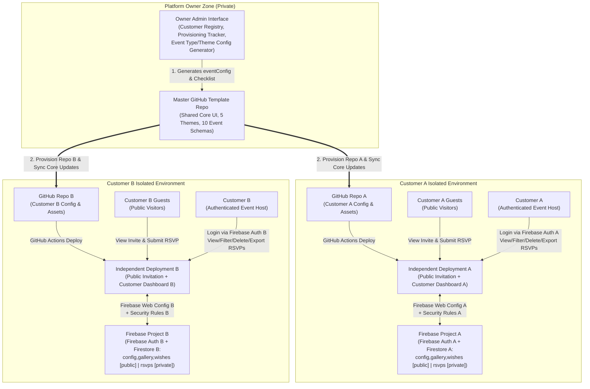
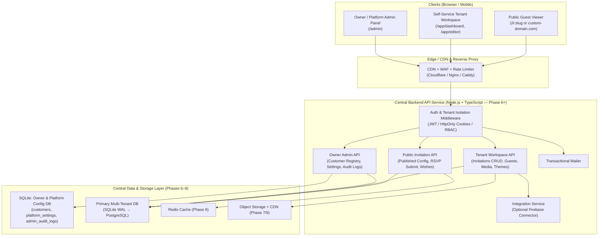
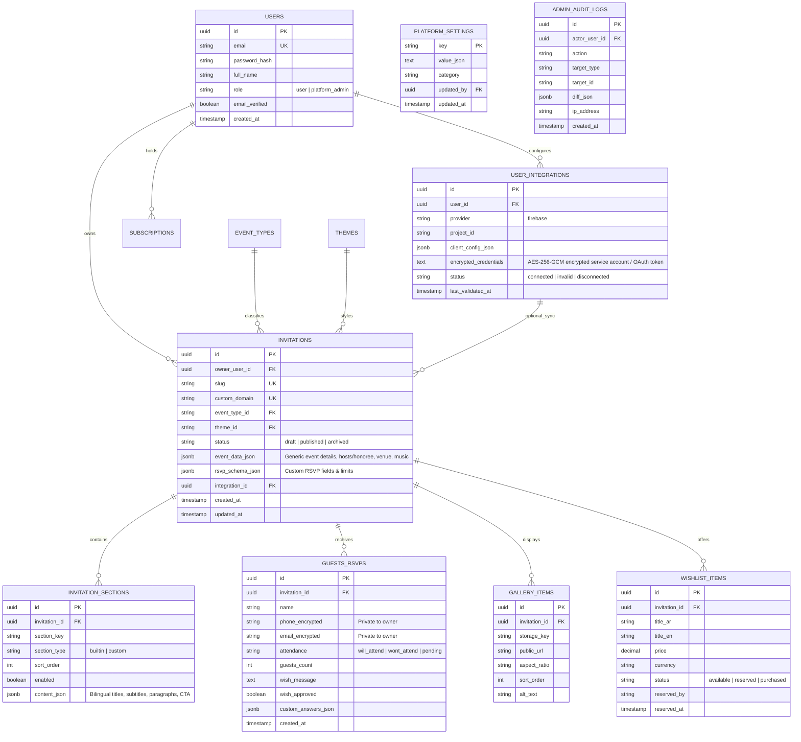
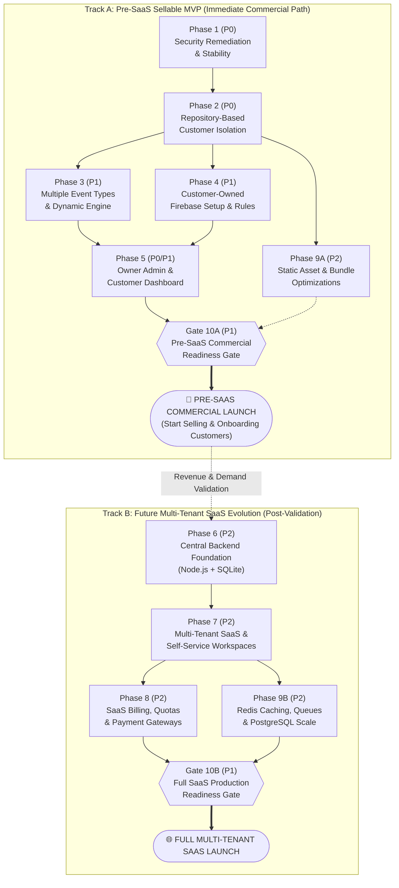

# UpgradPlan.md — Project-Wide Assessment, Pre-SaaS Sellable MVP & Future SaaS Roadmap

**Assessment Date:** November 17, 2026 (Updated November 19, 2026 — Operator-Managed Pre-SaaS MVP Strategy)  
**Repository:** `https://github.com/hamdyKouta1/invitation` (Branch: `main`, Head: `8b25c9e`)  
**Assessment Scope:** Full-stack source code, configuration, build/deployment pipeline, security posture, and product architecture review (Read-only assessment — zero source code or configuration modifications performed).

---

## 1. Executive Summary

The current project is a **single-event, client-only React 19 + Vite 8 wedding invitation application** built for a specific couple (Hamdy & Rodina), deployed statically to GitHub Pages, with optional Google Cloud Firestore synchronization and a browser-based admin portal (`AdminPortal.jsx` / `AdminApp.jsx`).

While the application delivers a polished luxury UI—featuring a 3D animated envelope, 5 rich visual themes (`default`, `elegant-luxury`, `minimalist-modern`, `romantic-floral`, `royal-classic`), Arabic RTL / English LTR bilingual support, and a dynamic section ordering/custom-section engine—it requires **immediate security remediation, customer data isolation, and role separation** before it can be sold to paying customers.

### Key Assessment Findings
1. **Critical Security Deficiencies:**
   - **Client-Side Authentication Bypass:** Admin credentials (`VITE_ADMIN_EMAIL`, `VITE_ADMIN_PASSWORD`) and legacy fallback credentials (`admin` / `wedding2026` / `123456`) are compiled directly into the public client-side JavaScript bundle (`src/components/Admin/AdminPortal.jsx#L66-L67`, `src/admin/AdminApp.jsx#L60-L61`, `L168-L169`).
   - **Client-Side 2FA/OTP:** OTP generation, storage (`sessionStorage`), and verification occur entirely in the user's browser (`src/services/mail/otpService.js#L37-L168`), allowing trivial bypass via DevTools.
   - **Unauthenticated Database Writes:** The documented Firestore security rules (`FIREBASE_INTEGRATION_GUIDE.md#L60-L78`) allow public `allow write: if true` on `config/{document}`, `gallery/{document}`, and `allow update, delete: if true` on `rsvps/{document}`.
2. **Lack of Customer Isolation & Role Separation:**
   - All data currently lives in a single shared Firestore project (`config/wedding`, `rsvps`, `gallery`, `wishlist`).
   - There is no separation between **Owner Admin** capabilities (provisioning customers, tracking repositories/Firebase projects, preparing event configurations) and **Customer Dashboard** capabilities (viewing RSVPs, filtering guests, deleting spam/unwanted submissions, exporting CSV).
3. **Wedding-Specific Hardcoding:**
   - Couple entities (`groom`, `bride`), family titles, personal names, GitHub Pages URLs (`https://hamdyKouta1.github.io/invitation/`), and wedding-only terminology are deeply embedded in `index.html`, `src/config/weddingConfig.js`, `src/utils/configManager.js`, `src/i18n/*.json`, and UI components.
4. **Configuration & Integration Coupling:**
   - Firebase is initialized once as a global singleton (`src/services/firebase/config.js#L14-L30`) from build-time `VITE_*` environment variables, with no automated validation or guardrails preventing cross-customer configuration mix-ups.

### Strategic Recommendation: Two-Stage Commercial Evolution
Rather than delaying revenue to build a complex centralized multi-tenant SaaS backend upfront, execute a **10-Phase Roadmap** divided into two distinct commercial stages:

1. **Stage A — Pre-SaaS Sellable MVP (Operator-Managed / Concierge Delivery: Phases 1–5 + Gate 10A):**
   - **Business Model:** Customers request an invitation website; the operator collects their event details/assets, provisions a **dedicated GitHub repository** from a clean master template, configures a **dedicated customer-owned Firebase project**, sets the event type/theme/content, and delivers a live URL + **Customer Dashboard**.
   - **Technical Path:** Remediate all critical security vulnerabilities (**Phase 1**), establish repository-per-customer and deployment isolation (**Phase 2**), generalize the UI to support 10 event types (**Phase 3**), enforce per-customer Firebase project isolation with Firebase Auth + hardened Firestore Security Rules (**Phase 4**), and separate the **Owner Admin** (private operator management interface) from the **Customer Dashboard** (per-customer RSVP/guest management) (**Phase 5**), passing the **Pre-SaaS Commercial Readiness Gate (Phase 10A)** to begin immediate sales and customer acquisition.
2. **Stage B — Future Multi-Tenant SaaS Platform (Deferred Until Business Validation: Phases 6–9 + Gate 10B):**
   - Once customer volume and revenue justify automation, introduce the centralized Node.js/TypeScript + **SQLite** backend foundation (**Phase 6**), self-service multi-tenant user accounts and workspaces (**Phase 7**), automated subscription billing and quotas via Stripe/Paymob (**Phase 8**), Redis/CDN/PostgreSQL scale optimizations (**Phase 9**), and full SaaS production compliance (**Phase 10B**).

---

## 2. Current Project Overview

| Attribute | Current Implementation |
|---|---|
| **Product Type** | Single-couple interactive digital wedding invitation |
| **Frontend Stack** | React `19.2.8`, Vite `8.2.0`, Framer Motion `13.1.1`, Lucide React `1.33.0` |
| **Form & Validation** | React Hook Form `7.85.0`, Zod `3.25.76`, `@hookform/resolvers` `5.9.1` |
| **Internationalization** | `i18next` `26.4.0`, `react-i18next` `17.0.12` (Arabic `ar` RTL / English `en` LTR) |
| **Backend / API** | **None** (100% client-side SPA; optional external `smtp-proxy` documented in `MAIL_SETUP.md` but not present in repo) |
| **Database / Storage** | Google Cloud Firestore (`firebase` `12.18.0`) + browser `localStorage` fallback (`mockService.js`) |
| **Linting / Tooling** | `oxlint` `1.75.0` (`.oxlintrc.json`), no test runner installed |
| **Hosting / Deployment** | Static hosting via `gh-pages` (`npm run deploy` pushes `dist/` to `origin/gh-pages`) |
| **Entry Points** | `index.html` → `src/main.jsx` → `src/App.jsx` (and `admin.html` → `src/admin/adminMain.jsx` → `src/admin/AdminApp.jsx`) |

---

## 3. Existing Architecture Assessment

### 3.1 Application Architecture
The codebase is a purely client-side Single Page Application (SPA) with two HTML entry points:
1. **`index.html` (`src/main.jsx` → `src/App.jsx`):** Renders the public invitation behind an interactive `Envelope` gate. Also conditionally renders `AdminPortal.jsx` as an overlay when the URL hash matches `#admin-secret`, `#admin`, `#${VITE_ADMIN_SECRET_ENDPOINT}`, or `?portal=admin` (`src/App.jsx#L114-L120`).
2. **`admin.html` (`src/admin/adminMain.jsx` → `src/admin/AdminApp.jsx`):** A standalone admin dashboard entry point. **Discrepancy:** `vite.config.js` does not configure `build.rollupOptions.input` for multi-page builds, so `npm run build` only bundles `index.html` and omits `admin.html` from `dist/` (verified in `origin/gh-pages` tree listing).

### 3.2 State & Configuration Flow
- **Context:** `WeddingConfigContext.jsx` holds the active invitation configuration in React state, initialized synchronously via `getActiveConfig()` (`src/utils/configManager.js#L247-L263`).
- **Sync Priority:** On mount, `AppContent` calls `syncConfigWithFirestore()` (`src/App.jsx#L128-L130`), and `WeddingConfigProvider` subscribes to `doc(db, 'config', 'wedding')` via `onSnapshot` (`src/services/firebase/firestore.js#L295-L314`).
- **Service Abstraction:** `src/services/index.js` dynamically imports either `./firebase/firestore.js` or `./mock/mockService.js` based on the build-time constant `import.meta.env.VITE_FIREBASE_ENABLED === 'true'` (`src/services/index.js#L9`).

### 3.3 Documented vs. Actual Behavior Discrepancies
1. **Standalone `admin.html` in Production:** Documented in `PROJECT_GUIDE.md#L396`, but excluded from Vite's production `dist/` output because `vite.config.js` lacks multi-page Rollup input configuration.
2. **`AdminApp.jsx` vs. `AdminPortal.jsx` Divergence:** `AdminApp.jsx` (1,848 lines) uses single-factor username/password login with hardcoded fallbacks (`'hamdy'`, `'admin'`, `'123456'`, `'wedding2026'`, lines 168–169), supports local `FileReader` base64 image uploads (lines 263–280), and hardcodes `http://localhost:5175` (line 568). `AdminPortal.jsx` (2,020 lines) uses 2FA email + OTP, omits local file upload, and adds `handleUploadDefaultToFirestore`. Both duplicate ~1,500 lines of identical JSX and state logic.
3. **2FA Security Claims:** `README.md` and `PROJECT_GUIDE.md` describe the admin portal as secured with "2-Factor Authentication", whereas `otpService.js` generates and verifies the OTP entirely in the browser's `sessionStorage`.
4. **`smtp-proxy` Directory:** `MAIL_SETUP.md#L35-L60` instructs users to `cd smtp-proxy`, which does not exist in the repository.
5. **Firebase Storage:** `src/services/firebase/config.js#L12,L29` initializes `getStorage(app)`, but `storage` is never imported or used anywhere; gallery photos are external URLs, Google Drive links, or base64 data URIs.
6. **Wishlist Firestore vs. Config Mismatch:** `firestore.js#L316-L344` reads/updates a top-level `wishlist` Firestore collection, while `AdminPortal.jsx` and `AdminApp.jsx` store wishlist items inside `config/wedding` (`wishlist.items`), and `Wishlist.jsx#L127-L131` short-circuits to `wishlistConfig.items` without calling Firestore when `wishlistConfig.items` is non-empty.
7. **GA4 Analytics (`useAnalytics.js`):** `useAnalytics.js#L10` checks `weddingConfig.analytics?.enabled` from the static file rather than live context, and no `gtag.js` script is loaded in `index.html`.
8. **Unused `date-fns` / `date-fns-tz`:** Installed in `package.json#L15-L16` and referenced in `useCountdown.js` comments, but `useCountdown.js` uses native `Date.getTime()` and `Date.now()`.

---

## 4. Current Features & Capabilities

| Feature | Implementation Files | Current Capability | Pre-SaaS MVP & Future SaaS Readiness |
|---|---|---|---|
| **3D Envelope & Wax Seal** | `Envelope.jsx`, `ThemeVisuals.jsx` | Animated flap, card reveal, theme-specific seal & colors | Reusable in Phase 3; requires dynamic event title & cover image |
| **5 Visual Themes** | `themesConfig.js`, `themes.css`, `ThemeVisuals.jsx`, `FloralCornerSVG.jsx`, `OrnamentDivider.jsx` | 5 cohesive themes with CSS variables, SVG crests, ambient particles, live preview banner | Reusable foundation; needs decoupling from wedding-only copy (Phase 3) |
| **Dynamic Section Engine** | `App.jsx`, `configManager.js`, `DynamicSectionsEditor.jsx`, `CustomSection.jsx` | Reorder, toggle visibility, override headings, add custom bilingual sections | Strong foundation for multi-event template engine (Phase 3) |
| **Bilingual i18n (AR/EN)** | `src/i18n/index.js`, `ar.json`, `en.json`, `rtl.css` | Full RTL/LTR switching with `localStorage` persistence | Needs event-agnostic labels (Phase 3) and dashboard/admin separation (Phase 5) |
| **Countdown Timer** | `Countdown.jsx`, `useCountdown.js` | Live days/hours/minutes/seconds with customizable completion quote | Reusable for any dated event |
| **Venue & Map** | `Venue.jsx` | Address display, Google Maps link, embedded iframe | Reusable; requires URL scheme sanitization (`SEC-006`, Phase 1) |
| **Photo Gallery & Lightbox** | `Gallery.jsx` | Masonry/grid layouts, Google Drive URL transform, touch-swipe lightbox | Isolated per-customer repo/Firebase in Phase 2/4; object storage in Phase 7/9 |
| **RSVP & Wishes Wall** | `RSVP.jsx`, `WishesWall.jsx` | Zod-validated form, `localStorage` duplicate guard, live wishes feed | Must split public `wishes` from private `rsvps` PII (`SEC-005`, Phase 1/4) |
| **Wishlist & Gifting** | `Wishlist.jsx` | Instapay, IBAN copy, external registry link, item reservation | Unify storage & replace `window.prompt()` modal (Phase 1/3) |
| **Admin Portal** | `AdminPortal.jsx`, `AdminApp.jsx`, `ThemeManager.jsx` | Guest CRUD, CSV/JSON export, KPIs, Gallery CRUD, Live Config Editor | Must be split into **Customer Dashboard** (RSVP/guest management) and **Owner Admin** (operator provisioning) in Phase 5 |

---

## 5. Technical Weaknesses

| ID | Category | Current Implementation | Identified Weakness | Business / Technical Impact | Severity | Recommended Solution | Target Phase | Priority |
|---|---|---|---|---|---|---|---|---|
| **ARC-001** | Architecture | 100% client-side SPA (`src/App.jsx`, `vite.config.js`) | No backend server or API layer; all business logic, auth, and DB access happen in the browser | In Pre-SaaS MVP, requires Firebase Auth + strict Firestore Security Rules for Customer Dashboard; for full SaaS, requires a Node.js + SQLite backend | **Critical** | **Pre-SaaS (Phases 1/4/5):** Use Firebase Auth + Firestore Security Rules per customer project. **Future SaaS (Phase 6):** Introduce Node.js + SQLite backend API | Phase 1 / 4 / 6 | P0 (Auth) / P2 (Backend) |
| **ARC-002** | Code Quality | `AdminApp.jsx` (1,848 lines) & `AdminPortal.jsx` (2,020 lines) | Massive code duplication with diverging auth and feature sets; conflates owner config with customer RSVP management | High maintenance cost, bug drift, and exposes operator settings to customers | **High** | Refactor into two clean, distinct interfaces in **Phase 5**: a lightweight **Customer Dashboard** (deployed per customer) and a private **Owner Admin** | Phase 5 | P0/P1 |
| **ARC-003** | Build Config | `vite.config.js#L5` | Hardcoded `base: '/invitation/'` in production and missing `admin.html` Rollup input | Breaks deploying customer repositories under different repo names (`/<customer-repo>/`) or custom domains | **High** | Parameterize `base: process.env.VITE_BASE_PATH \|\| '/'` in `vite.config.js` (**Phase 2**); configure multi-route SPA in **Phase 7** | Phase 2 / 7 | P0 |
| **ARC-004** | State / Data | `RSVP.jsx#L34-L36`, `firestore.js#L41-L43` | Duplicate RSVP prevention uses global `localStorage.getItem('wedding_rsvp_submitted')` | Collides across invitations tested in the same browser; trivially bypassed | **Medium** | Namespace `localStorage` keys by customer/repo slug (`rsvp_submitted_${projectId}`) in **Phase 2**; add server rate-limiting in **Phase 6** | Phase 2 / 6 | P1 |
| **ARC-005** | Data Model | `Wishlist.jsx#L127-L146` vs `firestore.js#L316-L344` | Dual conflicting storage for wishlist items (`config/wedding` vs `wishlist` collection) | Guest reservations in `Wishlist.jsx` may silently fail or desync from Admin UI | **Medium** | Unify wishlist item state and reservation updates cleanly within the customer's Firestore schema | Phase 1 / 4 | P1 |
| **ARC-006** | Validation / UX | `Wishlist.jsx#L149` | Uses `window.prompt()` for guest name on gift reservation | Poor mobile UX, no validation, cannot style or localize cleanly | **Low** | Replace with an accessible React modal dialog with Zod validation | Phase 3 | P2 |
| **ARC-007** | Dependencies | `package.json`, `useAnalytics.js`, `useCountdown.js` | Unused `date-fns`/`date-fns-tz`; `useAnalytics` reads static `weddingConfig` instead of context; `gtag.js` missing | Dead bundle weight and non-functional analytics | **Low** | Remove unused packages or wire `date-fns-tz` properly; inject GA4 dynamically from config | Phase 9 | P3 |

---

## 6. Customer Isolation, Scalability & Multi-Tenant Assessment

### 6.1 Current Isolation Gaps
Currently, the application is **single-instance by design**:
- **Single Config Document:** `firestore.js#L271,L286,L297` hardcodes `doc(db, 'config', 'wedding')`. Every visitor and admin reads and overwrites the exact same document in one Firebase project.
- **Unscoped Collections:** `rsvps` and `gallery` are root-level collections. Although `rsvps` writes an `invitationId` field (`firestore.js#L58`), `getWishes()` (`L73-L77`), `getGuests()` (`L128`), and `clearAllGuests()` (`L195`) **never filter by `invitationId`**.
- **Global LocalStorage Keys:** `wedding_config_override`, `wedding_active_theme`, `wedding_rsvps`, `wedding_gallery_images`, `wedding_rsvp_submitted`, and `wedding_lang` are global keys.

### 6.2 Two-Stage Customer Isolation Architecture

#### Stage A: Pre-SaaS Mandatory Customer Isolation (Phases 2, 4 & 5 — Immediate Commercial Model)
In the operator-managed / concierge model, strict customer isolation is enforced via **physical infrastructure and project separation** (`One Customer = One GitHub Repo + One Independent Deployment + One Independent Firebase Project`):

- **Customer A:** `GitHub Repository A` → `Independent Deployment A` → `Firebase Project A` → `Firebase Web Config A` → `Customer Dashboard A` → `Guest & RSVP Data A`.
- **Customer B:** `GitHub Repository B` → `Independent Deployment B` → `Firebase Project B` → `Firebase Web Config B` → `Customer Dashboard B` → `Guest & RSVP Data B`.

**Strict Isolation Guarantees:**
1. **Zero Shared Database:** Customer A and Customer B have completely separate Google Cloud Firestore databases and Firebase Auth user pools. Customer A can never query, mutate, or delete Customer B's RSVPs, guest phone numbers, wishes, gallery, or configuration.
2. **Independent Deployment & Rollback:** Each customer repository builds via its own GitHub Actions workflow using repository-scoped secrets (`VITE_FIREBASE_*`, `VITE_BASE_PATH`) and can be rolled back independently without affecting any other customer.
3. **Template Synchronization Without Overwrite:** A clean master **Template Repository** holds the shared application core (`src/components/*`, `src/styles/themes.css`, event engine). Customer-specific files (`src/config/eventConfig.js` / `weddingConfig.js`, custom assets) are isolated so template bugfixes/updates can be merged into customer repos via PR without overwriting customer data.
4. **Role & Permission Boundary:**
   - **Public Guests** on Deployment A can only read published event data/approved wishes and `create` validated RSVP submissions in Firebase Project A. They cannot read private guest phone numbers (`rsvps` private collection), edit config, or delete records.
   - **Customer A** logs into **Customer Dashboard A** (authenticated via Firebase Authentication in Firebase Project A) and can view, search, filter, export (CSV), and delete RSVP submissions exclusively within Firebase Project A. Customer A has zero access to Owner Admin or Customer B.
   - **Platform Owner** uses a separate, private **Owner Admin** interface to track customer records, repositories, Firebase project IDs, and initial configurations.

#### Stage B: Future Multi-Tenant SaaS Isolation (Phases 6 & 7 — Post-Validation Evolution)
When customer volume outgrows manual repository/Firebase provisioning, the platform can evolve to centralized logical multi-tenancy (`Platform → Users → Invitations → Event Data`):
1. **Tenant/User Boundary:** Every authenticated user receives a unique `user_id` (UUID).
2. **Invitation Ownership:** Every `invitation` record has `owner_user_id` and a unique `slug` (plus optional verified `custom_domain`).
3. **Resource Scoping & API Middleware:** Every database row carries `invitation_id`, and backend middleware verifies `invitation.owner_user_id === req.user.id` before reading or mutating data.

### 6.3 Realistic Scalability Analysis & Bottlenecks

| Growth Stage | Delivery Model & Scale Target | Potential Bottlenecks | Realistic Strategy & Architecture Changes |
|---|---|---|---|
| **Stage 0: Pre-SaaS Sellable MVP (Phases 1–5)** | **Operator-Managed Concierge:** 1–50 paying customers (1 repo + 1 Firebase project per customer) | Manual repo/Firebase setup takes ~15–20 mins per customer; static GitHub Pages bandwidth/build limits | GitHub Template Repo + documented provisioning checklist + per-customer Firebase Spark/Blaze plan (easily handles 10k+ reads/day per event) + Owner Admin tracker |
| **Stage 1: Early Automation / Hybrid (Phase 6)** | **Operator + Central Owner API:** 50–200 customers | Tracking puluhan customer repos/configs manually; repetitive setup steps | Lightweight Node.js + **SQLite (WAL mode)** backend for Owner Admin customer registry & semi-automated repo/config preparation while keeping customer RSVPs in their isolated Firebase projects |
| **Stage 2: Self-Service SaaS Growth (Phases 7–9)** | **Multi-Tenant SaaS:** 500–2,000 users, 5k–10k invitations, 100k+ RSVPs | SQLite single-writer lock under concurrent RSVP spikes; unindexed JSON queries; media hosting | Self-service workspaces (`/i/:slug`), **Redis** caching for published invitations, **Cloudflare R2/S3** + CDN for media, background job queues |
| **Stage 3: High-Volume Scale (Phase 9+)** | **Enterprise SaaS:** 5,000+ users, 25k+ invitations, viral traffic (1,000+ req/min) | SQLite single-node vertical ceiling; horizontal multi-instance scaling | Migrate central multi-tenant DB from SQLite to managed **PostgreSQL** with read replicas & connection pooling |

> **Capacity Note:** In the Pre-SaaS MVP (Stage 0), because every customer has a dedicated static deployment (GitHub Pages / Cloudflare Pages) and a dedicated Firebase project, traffic spikes on Customer A's wedding invitation have **zero performance impact** on Customer B's invitation.

---

## 7. Multiple Event Types Assessment

### 7.1 Current Wedding Coupling
The current codebase assumes every event is a heterosexual wedding with two families:
- `weddingConfig.js`: `groom`, `bride`, `father`, `mother`, `showMother`, `invitationPhraseAr/En` hardcoded to "حفل زفاف نجليهما / wedding of their children".
- `Families.jsx`: Hardcodes `groomFamily`, `brideFamily`, `sonOf`, `daughterOf`.
- `Hero.jsx`: Hardcodes `groomName & brideName` and `"ISSUE NO. 01 — THE WEDDING EDITION"`.
- `AdminPortal.jsx` / `AdminApp.jsx`: Hardcodes Groom/Bride form fields.
- `i18n/ar.json` & `en.json`: Hardcodes wedding phrasing across `hero`, `details`, `dressCode`, `wishes`, `rsvp`, `share`, `wishlist`.

### 7.2 Target Polymorphic Event-Type Architecture
Instead of building 10 separate apps, introduce a **Schema-Driven Event & Section Engine**:

1. **Event Type Registry (`event_types` table / template catalog):**
   - `wedding`, `engagement`, `birthday`, `private_party`, `graduation`, `baby_shower`, `anniversary`, `corporate`, `conference`, `custom`.
2. **Modular Section Catalog:**
   - **Universal Sections:** `hero`, `event_details` (date/time/timezone), `countdown`, `venue` (map + directions), `gallery`, `rsvp`, `wishes` (guestbook), `share`, `custom_section`.
   - **Event-Specific Sections:**
     - `hosts_families` (Weddings, Engagements, Anniversaries — supports 1 or 2 honorees + optional parent cards).
     - `honoree_profile` (Birthdays, Graduations, Baby Showers — name, optional age/degree/baby gender/milestone).
     - `agenda_schedule` (Corporate, Conferences, Weddings — multi-slot timeline).
     - `speakers_lineup` (Conferences, Corporate).
     - `dress_code` (Weddings, Parties, Corporate Galas — configurable palettes).
     - `gifting_registry` (Weddings, Baby Showers, Birthdays — cash/IBAN/Instapay + item list).
3. **Configurable RSVP Form Builder:**
   - Per-invitation RSVP field schema (e.g., `dietary_restrictions`, `company_name`, `job_title`, `plus_one_allowed`, `max_guests`, `custom_questions[]`).
4. **Backward Compatibility:**
   - Existing `weddingConfig.js` structure maps cleanly to `event_type: 'wedding'` via a versioned config adapter (`schemaVersion: 2`).

---

## 8. Static Data & Hardcoding Audit

| Finding ID | File & Line(s) | Hardcoded / Static Value | Classification | Dynamic Alternative & Target Phase |
|---|---|---|---|---|
| **CFG-001** | `index.html#L8-L27` | `"حمدى ورودينا — دعوة زفاف"`, Port Said description, `og-image.jpg`, `https://hamdyKouta1.github.io/invitation/` | User-Specific Runtime Data (Wrongly Static) | **Pre-SaaS (Phase 2/3):** Build-time Vite HTML variable replacement from customer config. **Future SaaS (Phase 7):** Edge/SSR meta-tag injection per `/i/:slug` |
| **CFG-002** | `src/config/weddingConfig.js#L9-L31,L81-L113,L240-L256` | Groom/Bride names, parents, date `2026-09-11`, Garden Grand Lamour, Port Said, Maps URL, GitHub Pages sharing URL | User-Specific Runtime Data | **Pre-SaaS (Phase 2/3):** Parameterize as customer-isolated `eventConfig` per repository. **Future SaaS (Phase 7):** Move to DB `invitations` table |
| **CFG-003** | `src/components/DressCode/DressCode.jsx#L30-L45` | `MEN_COLORS` and `WOMEN_COLORS` arrays | Static Design Default (Should be Overridable) | Store `dressCode.palettes` in event config with these arrays as template defaults (**Phase 3**) |
| **CFG-004** | `src/components/Hero/Hero.jsx#L86,L104-L105` & `ThemeVisuals.jsx#L218` | `"ISSUE NO. 01 — THE WEDDING EDITION"`, `"MMXXVI"`, `"ARCHITECTURAL SERIES MMXXVI"` | Hardcoded Event-Type Copy | Parameterize via `eventType.editorialLabel` and `event.yearRoman` (**Phase 3**) |
| **CFG-005** | `src/admin/AdminApp.jsx#L292,L532-L533,L556,L568` & `AdminPortal.jsx#L396,L745` | `"دعوة زفاف حمدى ورودينا"`, `http://localhost:5175`, `"الرمز الافتراضي: wedding2026"` | Hardcoded Personal Info & Env URL | Dynamically read active event title from customer config; use relative URLs (**Phase 1 / Phase 5**) |
| **CFG-006** | `src/components/Admin/ThemeManager.jsx#L41-L46` | Fallback strings `'حمـدى'`, `'رودينـا'`, `'٢١ أغسطس ٢٠٢٦'`, `'قاعة اللؤلؤة ببورسعيد'` | Hardcoded Sample Data | Use generic localized preview placeholders or active event data (**Phase 3**) |
| **CFG-007** | `src/services/mock/mockService.js#L59-L75` | `mockSampleWishes` mentioning Hamdy & Rodina | Sample Data | Restrict to dev/demo preview mode only; never merge into production customer data (**Phase 1**) |
| **CFG-008** | `src/services/firebase/firestore.js#L58,L155,L271,L286,L297` | Global `'config'/'wedding'` document path and static `weddingConfig.rsvp.invitationId` | Global Shared Config | **Pre-SaaS (Phase 4):** Dedicated Firebase project per customer + validated `projectId`. **Future SaaS (Phase 7):** Scope by `invitationId`/`tenantId` |
| **CFG-009** | `vite.config.js#L5` | `'/invitation/'` production base path | Environment-Specific Deployment Setting | Read `VITE_BASE_PATH` from environment (`process.env.VITE_BASE_PATH \|\| '/'`) for per-customer repo deployments (**Phase 2**) |
| **CFG-010** | `public/*.png`, `public/*.mp3`, `public/themes/*` | Personal couple illustrations & MP3s in `public/` root | Mixed (Theme Assets vs. User Media) | Keep `/themes/*` as system theme assets; clean personal files from template repo (**Phase 1 / Phase 2**) |

---

## 9. Firebase Integration Assessment & Mandatory Per-Customer Isolation

### 9.1 Current Coupling
- `src/services/firebase/config.js#L14-L30` initializes a single global Firebase `app`, `db`, and `storage` instance at module load using `import.meta.env.VITE_FIREBASE_*`.
- `src/services/index.js#L9` locks the entire app into Firebase or Mock mode at build time.
- There is no validation ensuring that a deployed customer site points to its own dedicated Firebase project rather than a default or shared project.

### 9.2 Critical Distinction: Firebase Web Configuration vs. Privileged Firebase Credentials
A foundational security rule across all phases of this roadmap is the strict distinction between public client configuration and privileged server credentials:

| Credential / Artifact | Security Classification | Where Stored & Used | Mandatory Security Rules |
|---|---|---|---|
| **Firebase Web Configuration** (`apiKey`, `authDomain`, `projectId`, `storageBucket`, `messagingSenderId`, `appId`) | **Public Client Configuration** (Identifies the customer's Firebase project to the browser SDK; **not** a secret key) | Stored in each customer repository's deployment environment (`VITE_FIREBASE_*` GitHub Actions Secrets / `.env.production`) pointing strictly to **that customer's dedicated Firebase project** | Safe in the browser **ONLY** when paired with **Firebase Authentication** and **hardened Firestore / Storage Security Rules**. Never share a `projectId` across two customers. |
| **Privileged Firebase Credentials** (Firebase Admin SDK Service Account JSON, `private_key`, `client_email`, Google Cloud IAM keys) | **Highly Sensitive Server Secrets** (Bypasses all Firestore Security Rules with full administrative privileges) | **NEVER** stored in frontend code, public GitHub repositories, browser storage, or `VITE_*` variables. If used in future server-side tooling (**Phase 6+**), stored strictly on the backend encrypted at rest (AES-256-GCM via `ENCRYPTION_MASTER_KEY`). | Any exposure in client bundles or public repos is a P0 security breach. Not required in the client-side **Pre-SaaS Sellable MVP (Phases 1–5)**. |

### 9.3 Pre-SaaS Per-Customer Firebase Architecture (Phase 4 — Immediate Commercial Model)
In the Pre-SaaS Sellable MVP, **every customer deployment connects to its own isolated Firebase project**:
1. **Dedicated Project Boundary:** Customer A uses `Firebase Project A`; Customer B uses `Firebase Project B`.
2. **Required Firebase Services per Customer Project:**
   - **Cloud Firestore (Mandatory):** Stores `config/event` (published invitation config), `wishes` (publicly readable approved guest wishes: name + message only), and `rsvps` (private guest response records including phone numbers, attendance status, guest count, and notes).
   - **Firebase Authentication (Mandatory for Customer Dashboard):** Email/Password (or Google Sign-In) enabled for the customer's account so the customer can sign in to their **Customer Dashboard** (`/dashboard` or `#dashboard`) and manage their own RSVPs.
   - **Firebase Storage (Optional):** Only needed if hosting gallery images directly in Firebase Storage instead of external/repo assets.
3. **Mandatory Firestore Security Rules Boundary:** Separate Firebase projects alone do not protect guest PII from public visitors on that customer's site. Each customer's Firebase project must enforce:
   - `config/{doc}` and `gallery/{doc}`: `allow read: if true; allow write: if request.auth != null;`
   - `wishes/{doc}`: `allow read: if true; allow create: if <valid schema>; allow update, delete: if request.auth != null;`
   - `rsvps/{doc}` (contains private guest phone numbers): `allow create: if <valid schema>; allow read, update, delete: if request.auth != null;` (Public visitors can **submit** an RSVP, but **only the authenticated customer** can read, filter, export, or delete RSVP records).

### 9.4 Future SaaS Hybrid Architecture Comparison (Deferred to Phase 6/7)
When the business later transitions from operator-provisioned repositories to a centralized multi-tenant SaaS platform (**Phases 6–7**), the platform can adopt a **Hybrid Database Architecture** where the central database (SQLite → PostgreSQL) serves as primary storage while optionally syncing with user-owned Firebase projects via server-side encrypted credentials.

---

## 10. Admin Architecture Decision: Owner Admin vs. Customer Dashboard

A core architectural decision for the product is splitting administrative responsibilities into **two separate products with distinct permissions, audiences, and security boundaries**, alongside a restricted **Public Guest Experience**.

### 10.1 Three-Tier Role & Interface Separation

| Interface / Role | Target User | Core Responsibilities | Strictly Forbidden Access | Authentication & Security Boundary |
|---|---|---|---|---|
| **A. Owner Admin (Private Operator Interface)** | **Platform Owner / Operator ONLY** (Never accessible to customers or guests) | • Register & manage customer records • Track each customer's GitHub repository URL, deployment URL, & Firebase `projectId` • Select event type, theme, & prepare initial invitation config (`eventConfig.js`) • Track provisioning & deployment status • Manage operator settings | • Must never embed GitHub PATs, GitHub App private keys, or Firebase Admin keys in frontend bundles • Must never rely on a hidden URL hash (`#admin-secret`) as fake "security" | **Pre-SaaS MVP (Phase 5):** Runs locally as a private operator tool/CLI or private authenticated operator app (backed by local SQLite or operator-only Firebase Auth UID allowlist). **Future SaaS (Phase 6):** Protected by server-side RBAC (`role === 'platform_admin'`) + SQLite `platform_settings` & `admin_audit_logs`. |
| **B. Customer Dashboard (Per-Customer RSVP & Guest Manager)** | **Individual Paying Customer** (Included in the first sellable MVP for each customer's site) | • Authenticate into their own dashboard • View submitted RSVP responses & guest names/phones • View attendance status (`will_attend`, `wont_attend`) & KPIs • Search & filter guest responses • Delete spam, inappropriate, or unwanted RSVPs/wishes • Export guest list to **CSV** | • **Never** accesses Owner Admin operations • **Never** accesses other customers' dashboards or Firebase projects • **Never** accesses platform-level settings or privileged credentials | **Pre-SaaS MVP (Phases 4 & 5):** Direct **Firebase Authentication** against the customer's own dedicated Firebase project + **Firestore Security Rules** (`request.auth != null && request.auth.token.email == <customer_email>`). Zero central multi-tenant backend required. |
| **C. Public Guest Experience** | **Event Guests / Public Visitors** | • Open the invitation URL • View published event details, countdown, venue, gallery, & approved wishes • Submit an RSVP response & wish | • **Never** reads private guest phone numbers or full RSVP list • **Never** modifies or deletes existing RSVPs • **Never** modifies event configuration • **Never** accesses Customer Dashboard or Owner Admin | Enforced by Firestore Security Rules (`allow create` only on `rsvps`; `allow read: if false` for anonymous users on `rsvps`). |

### 10.2 Dashboard Architecture Recommendation (Simplest Secure Pre-SaaS Design)
- **Customer Dashboard without a Central Backend:** Because every customer in the Pre-SaaS MVP has an independent Firebase project (**Phase 4**), the **Customer Dashboard** connects directly to that customer's Firebase Authentication and Firestore database. When the operator provisions `Firebase Project A` for `Customer A`, the operator creates Customer A's login account in Firebase Auth and deploys Firestore Security Rules restricting `rsvps` read/delete operations to `request.auth != null`.
- **Why This Is Ideal for MVP:** It delivers real cryptographic authentication (Firebase Auth JWTs verified by Google's Firestore rules engine) with **zero central backend server cost or maintenance**, while eliminating the insecure client-side password/OTP check (`SEC-001`, `SEC-002`).
- **Owner Admin Lightweight Design:** In Phase 5, the **Owner Admin** does not force a public cloud backend either. Since repo creation, Firebase setup, and deployment are intentionally manual in the initial concierge model, Owner Admin can run as a **private local operator workbench** (or private operator-authenticated portal) that generates validated customer config files, tracks customer metadata (in a local SQLite database or private operator store), and verifies provisioning checklists without exposing any privileged tokens in public client code.

### 10.3 SQLite Suitability & Operational Assessment (Owner Admin & Future Phase 6 Backend)
- **Pre-SaaS Owner Admin Local Persistence:** SQLite is ideal for storing the operator's customer registry, provisioning status tracker, and generated configuration history locally during the manual concierge phase.
- **Future Phase 6 Central Backend Persistence:** When a centralized Node.js/TypeScript backend is introduced in **Phase 6**, SQLite (`better-sqlite3` / Drizzle ORM in **WAL mode** with `PRAGMA foreign_keys = ON;` and atomic `admin_audit_logs`) will power central platform settings, feature flags, and audit logs, whiledeployment secrets (`JWT_SECRET`, `ENCRYPTION_MASTER_KEY`, `SMTP_PASS`) remain strictly in environment variables / secret managers.

---

## 11. Complete Security Audit

All findings below are verified against the current source code and configuration files and mapped to the new 10-phase roadmap.

| ID | Affected File(s) & Lines | Vulnerability Description | Evidence / Reproduction | Exploitability | Business Impact | Severity | Recommended Mitigation | Phase |
|---|---|---|---|---|---|---|---|---|
| **SEC-001** | `src/components/Admin/AdminPortal.jsx#L66-L67,L197-L207`, `src/admin/AdminApp.jsx#L60-L61,L167-L170` | **Hardcoded & Client-Exposed Admin Credentials:** `VITE_ADMIN_EMAIL` and `VITE_ADMIN_PASSWORD` are bundled into client JS by Vite. `AdminApp.jsx` also accepts hardcoded `'hamdy'`/`'admin'` and `'123456'`/`'wedding2026'`. | Any user can inspect the built `assets/index-*.js` bundle or set `sessionStorage.setItem('wedding_admin_2fa_auth', 'true')` in DevTools to gain full admin access. | **Trivial** | Complete unauthorized takeover of admin portal, guest PII, and site content | **Critical** | Remove all `VITE_ADMIN_*` credentials and hardcoded fallbacks from frontend code; replace with **Firebase Authentication** (Email/Password) in each customer's dedicated Firebase project (**Phase 1 / Phase 4 / Phase 5**). | Phase 1 |
| **SEC-002** | `src/services/mail/otpService.js#L37-L168`, `AdminPortal.jsx#L211-L267` | **Client-Side 2FA/OTP Bypass:** OTP is generated in browser (`generateOTP`), stored in plaintext `sessionStorage` (`wedding_admin_otp_session`), and verified client-side. | An attacker can read `sessionStorage.getItem('wedding_admin_otp_session')` in DevTools or skip Step 2 by setting `wedding_admin_2fa_auth` to `'true'`. | **Trivial** | 2FA provides zero actual security boundary | **Critical** | Remove fake client-side OTP (`otpService.js`) and `sessionStorage` auth flags; rely on Firebase Authentication ID tokens verified by Firestore Security Rules (and server-side auth in **Phase 6**). | Phase 1 |
| **SEC-003** | `FIREBASE_INTEGRATION_GUIDE.md#L53-L80`, `src/services/firebase/firestore.js` | **Unauthenticated Public Firestore Write/Delete Rules:** Documented rules grant `allow write: if true` on `config/{document}` and `gallery/{document}`, and `allow update, delete: if true` on `rsvps/{document}`. | Anyone with the public `firebaseConfig` (in the JS bundle) can read all guest phone numbers (`rsvps`), deface the site (`config/wedding`), or delete all guests. | **Trivial** | Mass PII breach (guest names/phones), site defacement, data destruction | **Critical** | Deploy hardened Firestore Security Rules requiring `request.auth != null` for all writes to `config`/`gallery` and all `read, update, delete` operations on `rsvps`. | Phase 1 / 4 |
| **SEC-004** | `src/services/mail/otpService.js#L50-L51,L96` | **Client-Side Mail Proxy Secret Exposure:** `VITE_MAIL_SERVER_SECRET` is embedded in the frontend bundle and sent in `x-api-secret` header from browser. | Any visitor can extract `VITE_MAIL_SERVER_SECRET` from JS and abuse the SMTP proxy to send spam. | **Easy** | Email relay abuse, domain blacklisting, credential leakage | **High** | Remove `VITE_MAIL_SERVER_*` and `VITE_EMAILJS_*` OTP calls from frontend bundle; use Firebase Auth built-in password reset / email verification (or backend mail service in **Phase 6**). | Phase 1 |
| **SEC-005** | `src/components/RSVP/RSVP.jsx`, `src/services/firebase/firestore.js#L45-L68,L126-L137` | **PII Exposure & Unauthenticated RSVP Spam:** `rsvps` documents store guest `phone` numbers alongside `message`. Public `allow read: if true` exposes all guest phones to any anonymous visitor querying Firestore. | Anonymous `getDocs(collection(db, 'rsvps'))` returns all names and phone numbers. | **Easy** | Privacy violation (GDPR/local data protection), guest harassment | **High** | Split public `wishes` collection (stores `name`, `message`, `createdAt` only — publicly readable) from private `rsvps` collection (stores `phone`, `attendance`, `guestsCount` — `allow create` for public with schema validation, `allow read, delete: if request.auth != null`). | Phase 1 / 4 |
| **SEC-006** | `src/components/CustomSection/CustomSection.jsx#L99`, `Wishlist.jsx#L75,L256`, `Venue.jsx#L31,L90` | **Unsafe URL Schemes (`javascript:` / `data:`):** Admin/user-supplied URLs (`ctaUrl`, `link`, `registryUrl`, `mapsUrl`, `mapsEmbedUrl`) are rendered directly in `href` / `window.open` / `iframe src` without protocol validation. | If an untrusted/compromised config contains `javascript:alert(1)` in `ctaUrl`, clicking the button executes JS (XSS). | **Medium** | Stored XSS on invitation pages | **High** | Enforce strict URL allowlist (`https://` and `http://` only) via Zod schema validation and a shared `sanitizeUrl()` helper before rendering. | Phase 1 |
| **SEC-007** | `src/admin/AdminApp.jsx#L263-L280` | **Unvalidated Base64 Image Upload & XSS Risk:** `handleFileUpload` accepts any `image/*` (including `image/svg+xml`, which can contain `<script>` tags) with no file size limit and stores raw base64 in config/Firestore. | Uploading a malicious SVG or a 15MB image can exceed Firestore's 1MB document limit or introduce SVG XSS if opened directly. | **Medium** | DoS (1MB Firestore doc crash), storage bloat, potential SVG XSS | **Medium** | Restrict image uploads/inputs to raster formats (`image/jpeg`, `image/png`, `image/webp`) with max size check (e.g., 2MB) and block raw SVG data URIs. | Phase 1 |
| **SEC-008** | `package.json`, `npm audit` output | **Vulnerable Dependencies:** `npm audit` (run Nov 17, 2026) reported **8 high-severity vulnerabilities** across `firebase` (`@firebase/firestore`, `@grpc/grpc-js`), `vite` (`8.2.0–8.2.2`), `zod` (`<4.6.6`), `re2js`, and `source-map-js`. | Known CVEs in installed `node_modules` tree. | **Low–Medium** | Supply-chain / runtime vulnerabilities depending on usage | **Medium** | Run `npm audit fix` for `vite`/`re2js`/`source-map-js`; upgrade `zod` and `firebase` SDK in **Phase 1**. | Phase 1 |
| **SEC-009** | `vite.config.js`, `index.html` (Static GitHub Pages) | **Missing Security Headers & Rate Limiting:** Static GitHub Pages hosting provides no `Content-Security-Policy` meta tag or Firestore rule abuse guards. | Susceptible to XSS escalation and unthrottled RSVP document creation. | **Medium** | Brute-force & RSVP spam risk | **Medium** | **Pre-SaaS (Phase 1/4):** Add CSP `<meta>` tag in `index.html`, Firebase Auth brute-force protection, and strict Firestore rule field/size validation (optional Firebase App Check). **Future SaaS (Phase 6/10):** Add Helmet & API rate limiting. | Phase 1 / 6 |
| **SEC-010** | `origin/gh-pages` branch | **Build Artifact Leakage:** `.env.example`, `.oxlintrc.json`, and `mockData` are published in `origin/gh-pages` root. | Visible at `https://hamdyKouta1.github.io/invitation/.env.example`. | **Low** | Information disclosure of config structure | **Low** | Clean `public/` clutter (`-2.png`, `1.png`, etc.) and ensure `dist/` only contains required public assets. | Phase 1 |

---

## 12. Business & Product Gap Analysis

Under the newly agreed **Operator-Managed Pre-SaaS MVP → Future SaaS** strategy, product capabilities are classified into **Pre-SaaS Sellable MVP (Phases 1–5 + Gate 10A)** versus **Future SaaS Platform (Phases 6–9 + Gate 10B)**:

| Area | Capability | Classification | Delivery Mechanism |
|---|---|---|---|
| **Customer Isolation & Provisioning** | Dedicated GitHub repo, independent deployment, & dedicated Firebase project per customer from a master template | **Pre-SaaS Sellable MVP (Phases 2 & 4)** | Operator-managed manual provisioning workflow + template sync |
| **Multiple Event Types & Themes** | 5 luxury visual themes + 10 event types (Wedding, Engagement, Birthday, Party, Graduation, Baby Shower, Anniversary, Corporate, Conference, Custom) | **Pre-SaaS Sellable MVP (Phase 3)** | Schema-driven event & section engine configured per customer repo |
| **Customer Dashboard (RSVP Manager)** | Customer login (Firebase Auth), view RSVPs & attendance stats, search/filter guests, delete spam/unwanted RSVPs, CSV export | **Pre-SaaS Sellable MVP (Phase 5 - Part 2)** | Deployed with each customer's site, connected strictly to their Firebase project |
| **Owner Admin (Operator Interface)** | Private operator tool to manage customer records, track repos/URLs/Firebase projects, select event type/theme, & prepare config | **Pre-SaaS Sellable MVP (Phase 5 - Part 1)** | Private operator interface (separate from customer sites & Customer Dashboard) |
| **Pre-SaaS Legal & Privacy Baseline** | Guest data privacy (hiding guest phones from public visitors), customer RSVP deletion capability, deployment/rollback runbook | **Pre-SaaS Sellable MVP (Phase 1 & Gate 10A)** | Hardened Firestore rules (`wishes` vs `rsvps`) + operator checklist |
| **Central Backend & SQLite API** | Centralized Node.js/TypeScript API + SQLite database for platform settings, audit logs, and automated provisioning | **Deferred to Future SaaS (Phase 6)** | Introduced only when customer volume justifies backend operations |
| **Self-Service Onboarding & Multi-Tenancy** | Public user registration, self-service multi-invitation workspace, `/i/:slug` routing, direct R2/S3 media upload quotas | **Deferred to Future SaaS (Phase 7)** | Full multi-tenant SaaS application |
| **Automated Monetization & Billing** | Subscription tiers (Free/Pro/Business), usage quotas, Stripe / Paymob payment gateways, automated custom domain SSL | **Deferred to Future SaaS (Phase 8)** | In Pre-SaaS MVP, payments & custom domain CNAMEs are handled manually by operator |

### Payment Strategy: Pre-SaaS vs. Future SaaS
- **Pre-SaaS Sellable MVP (Immediate):** Collect payments directly from customers via bank transfer, Instapay, or manual payment links before provisioning their dedicated repository and Firebase project. Zero payment gateway code is required to start selling.
- **Future SaaS (Phase 8):** Introduce a **Billing Provider Adapter** supporting **Stripe** (global cards) and **Paymob / Fawry / Kashier** (Egypt/MENA local cards and mobile wallets).

---

## 13. Infrastructure & Performance Assessment

1. **Pre-SaaS Static Architecture (Phases 1–5):**
   - Each customer website remains a fast, globally cached static build (GitHub Pages, Cloudflare Pages, or Vercel/Netlify static hosting) talking directly to that customer's dedicated Firebase project (Firestore + Firebase Auth).
   - **Bundle & Asset Hygiene:** Remove unused personal media (`-2.png`, `1.png`, `Die-with-a-smile.mp3`) from the template repository's `public/` folder so customer repositories remain lightweight.
   - **Testing Baseline:** Add **Vitest** unit tests (for URL sanitization, event-type schema adapters, and config merging) and **Firestore Rules / Isolation verification tests** before onboarding paying customers.
2. **Future Centralized SaaS Infrastructure (Deferred to Phases 6–9):**
   - **Frontend / Backend Separation (Phase 6/7):** Introduce a Node.js + TypeScript REST API + SQLite (WAL mode) with server/edge Open Graph `<meta>` injection for `/i/:slug`.
   - **Object Storage, Redis Caching & Queues (Phase 9):** Introduce Cloudflare R2/S3 media storage, Redis caching for read-heavy endpoints, background workers, and eventual PostgreSQL migration only when measurable multi-tenant traffic demands it.

---

## 14. Target Architecture

### 14.1 Stage A: Pre-SaaS Sellable MVP Architecture (Phases 1–5 — Immediate Commercial Launch)

### 14.2 Stage B: Future Multi-Tenant SaaS Architecture (Deferred to Phases 6–9)

---

## 15. Recommended Database & Data Ownership Model

### 15.1 Pre-SaaS Per-Customer Data Model (Phases 1–5)
In the Pre-SaaS Sellable MVP, data is physically partitioned across each customer's dedicated Firebase project and the operator's private Owner Admin store:

1. **Per-Customer Firestore Database (`Firebase Project <Customer>`):**
   - `config/event` (or `config/wedding` for backward compatibility): Stores published event metadata, event type (`wedding`, `birthday`, `corporate`, etc.), active theme ID, section order, custom sections, and wishlist items. (`allow read: if true; allow write: if request.auth != null;`)
   - `gallery/{imageId}`: Stores customer gallery image URLs, aspect ratios, sort order, and captions. (`allow read: if true; allow write: if request.auth != null;`)
   - `wishes/{wishId}`: Stores **only public guestbook fields** (`name`, `message`, `createdAt`) so public visitors can read the Wishes Wall without ever accessing guest phone numbers. (`allow read: if true; allow create: if <valid>; allow update, delete: if request.auth != null;`)
   - `rsvps/{rsvpId}`: Stores **private guest response records** (`name`, `phone`, `attendance`, `guestsCount`, `message`, `customAnswers`, `createdAt`). (`allow create: if <valid>; allow read, update, delete: if request.auth != null;` — accessible **exclusively** to the authenticated customer in their Customer Dashboard).
2. **Owner Admin Private Store (Platform Operator Only — Phase 5):**
   - Tracks `customers` (`id`, `customer_name`, `contact_email`, `contact_phone`, `event_type`, `theme_id`, `github_repo_url`, `deployment_url`, `firebase_project_id`, `provisioning_status`, `created_at`, `notes`). Never exposed to customer deployments.

### 15.2 Future Multi-Tenant SaaS Relational ERD (Deferred to Phases 6–8)
When the platform later introduces centralized multi-tenant workspaces (**Phase 7**) and subscriptions (**Phase 8**), every tenant-owned table enforces strict foreign-key ownership back to `users(id)` and `invitations(id)`:

---

## 16. Prioritized 10-Phase Upgrade Roadmap

The roadmap is structured into **10 Phases**:
- **Phases 1–5 (+ Gate 10A)** form the **Pre-SaaS Sellable MVP (Operator-Managed / Concierge Delivery)**, allowing the business to begin selling and onboarding paying customers immediately without building a central multi-tenant SaaS backend.
- **Phases 6–9 (+ Gate 10B)** represent **Future Platform Evolution**, deferred until customer demand and revenue justify building centralized multi-tenant infrastructure.

---

### Phase 1 – Security Remediation & Application Stability
- **Priority:** **P0 – Mandatory before customer onboarding**
- **Objectives:**
  - Remove all exposed admin credentials (`VITE_ADMIN_*`, hardcoded fallbacks) and privileged secrets (`VITE_MAIL_SERVER_SECRET`) from the frontend bundle.
  - Eliminate fake client-side authentication (`sessionStorage` flags and browser-generated OTPs in `otpService.js`).
  - Secure Firestore access and protect private guest PII (`phone` numbers) from public reads.
  - Validate user-supplied URLs (`sanitizeUrl()`) and restrict image uploads to safe raster formats.
  - Resolve critical/high dependency vulnerabilities (`npm audit fix`), add baseline CSP headers, clean unnecessary sensitive/sample files from `public/` and deployment outputs, and establish a minimum automated testing baseline (**Vitest**).
- **Issues Addressed:** `SEC-001`, `SEC-002`, `SEC-003`, `SEC-004`, `SEC-005`, `SEC-006`, `SEC-007`, `SEC-008`, `SEC-009`, `SEC-010`, `ARC-005`, `CFG-007`, `CFG-010`.
- **Proposed Technical Changes:**
  - Strip `VITE_ADMIN_EMAIL`, `VITE_ADMIN_PASSWORD`, `VITE_MAIL_SERVER_SECRET`, and hardcoded fallbacks (`'hamdy'`, `'admin'`, `'123456'`, `'wedding2026'`) from `src/components/Admin/AdminPortal.jsx`, `src/admin/AdminApp.jsx`, and `src/services/mail/otpService.js`.
  - Split public guest wishes (`wishes` collection: `name`, `message`, `createdAt` only) from private RSVP records (`rsvps` collection: includes `phone`, `attendance`, `guestsCount`) in `src/services/firebase/firestore.js`.
  - Update Firestore Security Rules so `rsvps` allows `create` with field validation for public guests, while `read, update, delete` on `rsvps` and `write` on `config`/`gallery` require `request.auth != null`.
  - Add `sanitizeUrl()` helper enforcing `https://` / `http://` allowlist in `CustomSection.jsx`, `Wishlist.jsx`, and `Venue.jsx`.
  - Restrict local image upload (`AdminApp.jsx#L263-L280`) to `image/jpeg`, `image/png`, `image/webp` (max 2MB, no SVG data URIs) and unify wishlist item state (`ARC-005`).
  - Run `npm audit fix`, add a baseline `Content-Security-Policy` `<meta>` tag in `index.html`, remove unused personal files from `public/`, and add Vitest unit tests.
- **Affected Files:** `src/components/Admin/AdminPortal.jsx`, `src/admin/AdminApp.jsx`, `src/services/mail/otpService.js`, `src/services/firebase/firestore.js`, `src/components/CustomSection/CustomSection.jsx`, `src/components/Wishlist/Wishlist.jsx`, `src/components/Venue/Venue.jsx`, `index.html`, `FIREBASE_INTEGRATION_GUIDE.md`, `package.json`, `package-lock.json`.
- **Dependencies:** None (Entry phase).
- **Implementation Tasks:**
  1. *(Parallel)* Remove hardcoded credentials, `VITE_ADMIN_*`, and client-side OTP (`otpService.js`) from frontend bundle.
  2. *(Parallel)* Refactor `firestore.js` to separate public `wishes` from private `rsvps` and write hardened `firestore.rules`.
  3. *(Parallel)* Implement `sanitizeUrl()` across `CustomSection`, `Wishlist`, and `Venue`, plus raster-only upload validation.
  4. *(Sequential)* Run `npm audit fix`, clean `public/` clutter, add Vitest baseline tests, and verify `npm run build`.
- **Expected Deliverables:** Hardened frontend bundle with zero embedded secrets, separated `wishes`/`rsvps` Firestore collections, hardened `firestore.rules`, and passing Vitest security unit tests.
- **Acceptance Criteria:**
  - Searching `dist/assets/*.js` yields zero occurrences of admin passwords, emails, or mail secrets.
  - No public unauthorized Firestore `update`/`delete` operations or anonymous reads of `rsvps` (guest phone numbers).
  - `javascript:` and `data:text/html` URLs are rejected by `sanitizeUrl()`.
  - Critical and high security findings (`SEC-001`–`SEC-010`) are resolved or mitigated, and existing invitation functionality works intact.
- **Testing Requirements:** Bundle secret scan (`grep`), Vitest unit tests for `sanitizeUrl()` and upload validators, Firestore Rules emulator/live anonymous read rejection test.
- **Risks & Rollback:** Removing legacy client-side auth requires pairing with Firebase Auth (completed in Phase 4/5); keep existing Hamdy & Rodina deployment on a tagged release (`v3.0.0`) for instant rollback.
- **Estimated Complexity:** Small–Medium | **Priority:** **P0**

---

### Phase 2 – Repository-Based Customer Isolation
- **Priority:** **P0 – Mandatory for the first commercial version**
- **Objectives:**
  - Maintain a clean master **GitHub Template Repository** containing the shared application core.
  - Create an independent GitHub repository and independent deployment for every customer.
  - Use an independent Firebase project for each customer.
  - Keep customer-specific configuration and assets isolated from shared template code so core updates never overwrite customer data.
  - Support independent deployment and rollback per customer, and document the manual operator provisioning workflow.
- **Expected Provisioning Flow:**
  `Customer Details → Template Repository → Customer Repository → Firebase Project → Configuration → Deployment → Customer URL`
- **Issues Addressed:** `ARC-003`, `ARC-004`, `SCL-001`, `CFG-001`, `CFG-002`, `CFG-009`, `CFG-010`, `ISO-001`, `ISO-002`, `ISO-003`, `ISO-004`.
- **Proposed Technical Changes:**
  - Parameterize `vite.config.js` (`base: process.env.VITE_BASE_PATH || '/'`) and inject build-time Open Graph `<meta>` tags (`VITE_OG_TITLE`, `VITE_OG_DESCRIPTION`, `VITE_OG_IMAGE`, `VITE_SITE_URL`) into `index.html`.
  - Namespace all `localStorage` keys (`wedding_config_override`, `wedding_rsvp_submitted`, etc.) using the customer's `VITE_FIREBASE_PROJECT_ID` or repo slug so browser storage never collides across customer sites.
  - Isolate customer-specific configuration into `src/config/customerConfig.js` (or `weddingConfig.js` protected by `.gitattributes` `merge=ours`) and customer assets under `public/customer/`.
  - Create `.github/workflows/deploy.yml` in the template repo to build and deploy each customer repository independently using its own GitHub Actions Secrets (`VITE_FIREBASE_*`, `VITE_BASE_PATH`).
  - Document the step-by-step **Manual Customer Provisioning & Template Sync Runbook**.
- **Affected Files:** `vite.config.js`, `index.html`, `src/utils/configManager.js`, `src/components/RSVP/RSVP.jsx`, `.github/workflows/deploy.yml`, `.gitattributes`, `DEPLOYMENT.md`.
- **Dependencies:** Phase 1.
- **Implementation Tasks:**
  1. *(Sequential)* Update `vite.config.js` and `index.html` to support dynamic `VITE_BASE_PATH` and customer-specific Open Graph meta variables.
  2. *(Parallel)* Namespace all `localStorage` keys by customer project ID (`ARC-004`).
  3. *(Parallel)* Configure `.gitattributes` (`merge=ours` on customer config files) and `.github/workflows/deploy.yml` for per-repo deployment.
  4. *(Sequential)* Write the Operator Provisioning Checklist and verify with two independent test customer repositories (`Customer A` and `Customer B`).
- **Expected Deliverables:** Clean Master Template Repository, parameterized build/deploy workflow, `.gitattributes` sync protection, and Operator Provisioning Runbook.
- **Mandatory Acceptance Criteria:**
  1. Provision Customer A and Customer B independently from the template repository.
  2. Customer A uses Firebase Project A.
  3. Customer B uses Firebase Project B.
  4. RSVP submissions from Customer A's website appear only in Firebase Project A.
  5. RSVP submissions from Customer B's website appear only in Firebase Project B.
  6. Customer A cannot read, update, or delete Customer B's records.
  7. Customer B cannot read, update, or delete Customer A's records.
  8. Each customer repository can be deployed and rolled back independently.
  9. A shared template update can be applied to both repositories without overwriting customer-specific configuration.
  10. Both customer websites remain 100% functional after independent deployment.
- **Testing Requirements:** End-to-end 2-customer isolation test (`Customer A` vs `Customer B`), template upstream merge test, and independent `gh-pages` rollback test.
- **Risks & Rollback:** Operator misconfiguring GitHub Secrets during manual setup; mitigated by a build-time config validation script that fails the build if `VITE_FIREBASE_PROJECT_ID` is missing.
- **Estimated Complexity:** Small–Medium | **Priority:** **P0**

---

### Phase 3 – Multiple Event Types & Dynamic Invitation Engine
- **Priority:** **P1 – Core commercial product capability**
- **Objectives:**
  - Expand the product beyond weddings to support all **10 commercial event types** within the same reusable template codebase: **Wedding, Engagement, Birthday, Private Party, Graduation, Baby Shower, Anniversary, Corporate Event, Conference, and Custom Event**.
  - Preserve and extend the existing 5 visual themes (`default`, `elegant-luxury`, `minimalist-modern`, `romantic-floral`, `royal-classic`), dynamic section ordering, custom sections, and Arabic RTL / English LTR bilingual support.
  - Ensure 100% backward compatibility with the existing Hamdy & Rodina wedding configuration.
- **Issues Addressed:** `CFG-002`, `CFG-003`, `CFG-004`, `CFG-006`, `ARC-006`, `BUS-004`.
- **Proposed Technical Changes:**
  - Define an **Event-Type Schema & Preset Catalog** (`src/config/eventTypesConfig.js`) for the 10 event types with default section ordering, bilingual labels, and event-specific metadata.
  - Generalize wedding-hardcoded components while keeping a `schemaVersion` adapter so existing `weddingConfig.js` files continue to work without breaking:
    - `Hero.jsx`: Support 1 or 2 honorees/hosts, event title/headline, and dynamic badge copy (`CFG-004`).
    - `Families.jsx` → `HostsAndHonorees.jsx`: Render couple parents for Weddings/Engagements, or honoree/host profiles for Birthdays, Graduations, Baby Showers, and Corporate events.
    - `WeddingDetails.jsx` → `EventDetails.jsx`: Dynamic event labels and optional multi-slot **Agenda / Schedule** items (for Conferences, Corporate events, Weddings).
    - `DressCode.jsx`: Allow custom color palettes from config while keeping `MEN_COLORS`/`WOMEN_COLORS` as defaults (`CFG-003`).
    - `Wishlist.jsx`: Replace `window.prompt()` with an accessible bilingual React reservation modal (`ARC-006`).
    - `RSVP.jsx`: Support configurable event-specific RSVP fields (e.g., company/title for Conferences, dietary notes, or max companions).
- **Affected Files:** `src/config/eventTypesConfig.js` (new), `src/config/weddingConfig.js`, `src/utils/configManager.js`, `src/components/Hero/Hero.jsx`, `src/components/Families/Families.jsx`, `src/components/WeddingDetails/WeddingDetails.jsx`, `src/components/DressCode/DressCode.jsx`, `src/components/Wishlist/Wishlist.jsx`, `src/components/RSVP/RSVP.jsx`, `src/i18n/ar.json`, `src/i18n/en.json`.
- **Dependencies:** Phase 2.
- **Implementation Tasks:**
  1. *(Sequential)* Create `eventTypesConfig.js` defining the 10 event types and backward-compatible `mergeConfig()` adapter.
  2. *(Parallel)* Generalize `Hero`, `Families`, `WeddingDetails`, `DressCode`, and `i18n` translations to render event-appropriate headings and fields.
  3. *(Parallel)* Add reusable `AgendaSchedule` / `HonoreeProfile` section support and replace `window.prompt()` in `Wishlist.jsx`.
  4. *(Sequential)* Verify all 5 visual themes across Wedding, Birthday, Graduation, and Corporate Conference presets in both Arabic (RTL) and English (LTR).
- **Expected Deliverables:** 10-event-type schema engine, reusable event-specific sections, accessible wishlist reservation modal, and backward-compatible wedding adapter.
- **Acceptance Criteria:**
  - At least the first commercially selected event types (and all 10 schema presets) render end-to-end with event-appropriate labels, sections, and RSVP fields.
  - All 5 visual themes apply cleanly to any selected event type without wedding-only text leakage.
  - The existing Hamdy & Rodina wedding configuration renders identically with zero regressions.
- **Testing Requirements:** Vitest schema adapter tests for all 10 event types + legacy `weddingConfig.js`; RTL/LTR rendering checks across all 5 themes.
- **Risks & Rollback:** Theme CSS selectors tied to old class names; preserve existing CSS class names in `themes.css` while generalizing text content.
- **Estimated Complexity:** Medium–Large | **Priority:** **P1**

---

### Phase 4 – Customer-Owned Firebase Integration & Setup
- **Priority:** **P1 – Required for customer data management**
- **Objectives:**
  - Configure each customer website deployment to connect strictly to its own dedicated Firebase project.
  - Initialize Firebase independently per deployment using public **Firebase Web Configuration** (`VITE_FIREBASE_*`) while ensuring **Privileged Firebase Admin SDK credentials** are never used or exposed in frontend code or repositories.
  - Enable **Firebase Authentication** and deploy hardened **Firestore Security Rules** per customer project to power the Customer Dashboard securely.
  - Prevent accidental cross-customer Firebase configuration mix-ups via build-time and runtime validation.
- **Issues Addressed:** `SEC-003`, `SEC-005`, `CFG-008`, `INT-001`, `ISO-001`, `ISO-002`.
- **Proposed Technical Changes:**
  - Update `src/services/firebase/config.js` to validate required `VITE_FIREBASE_*` keys on startup and optionally verify `VITE_EXPECTED_CUSTOMER_SLUG` / `projectId` match during build.
  - Enable Firebase Authentication (`getAuth(app)`, `signInWithEmailAndPassword`, `signOut`, `onAuthStateChanged`) in `src/services/firebase/` for Customer Dashboard authentication.
  - Provide a version-controlled `firestore.rules` and `firebase.json` template in the repository that enforces:
    - Public visitors: `read` on `config`, `gallery`, `wishes`; validated `create` on `rsvps` and `wishes`.
    - Authenticated customer (`request.auth != null`): `read, delete, update` on `rsvps` and `wishes` within their own Firebase project.
  - Document the operator's step-by-step **Customer Firebase Setup Guide** (creating project, enabling Auth + Firestore, deploying `firestore.rules`, creating the customer's login credentials, and setting GitHub repo secrets).
- **Affected Files:** `src/services/firebase/config.js`, `src/services/firebase/auth.js` (new), `src/services/firebase/firestore.js`, `firestore.rules` (new), `FIREBASE_INTEGRATION_GUIDE.md`.
- **Dependencies:** Phase 1, Phase 2.
- **Implementation Tasks:**
  1. *(Sequential)* Add Firebase Auth service module (`signIn`, `signOut`, `onAuthStateChanged`) and strict config validation in `src/services/firebase/config.js`.
  2. *(Sequential)* Author and test `firestore.rules` enforcing public-write/private-read on `rsvps` and authenticated customer access.
  3. *(Parallel)* Add a pre-build validation script (`scripts/verify-firebase-config.mjs`) that aborts CI builds if `VITE_FIREBASE_PROJECT_ID` is missing or matches a blocklisted/template placeholder ID.
  4. *(Parallel)* Update `FIREBASE_INTEGRATION_GUIDE.md` with the operator's per-customer setup checklist.
- **Expected Deliverables:** Per-customer Firebase Auth + Firestore integration, versioned `firestore.rules`, pre-build project-ID guard script, and operator setup guide.
- **Acceptance Criteria:**
  - Each customer deployment initializes its own Firebase project exclusively via public Web Config (`VITE_FIREBASE_*`).
  - Zero Firebase Admin SDK service-account keys or private keys exist anywhere in the repo, `.env`, or frontend bundle.
  - Unauthenticated requests to read or delete `rsvps` in Firestore are rejected with `PERMISSION_DENIED`.
  - Authenticated customer requests to read or delete `rsvps` in their own Firebase project succeed.
- **Testing Requirements:** Firestore Security Rules test suite (anonymous `getDocs(rsvps)` → denied; anonymous `addDoc(rsvps)` → allowed; authenticated customer `getDocs/deleteDoc(rsvps)` → allowed).
- **Risks & Rollback:** Operator forgetting to publish `firestore.rules` on a new Firebase project; include a one-command `npx firebase-tools deploy --only firestore:rules --project <project-id>` step in the operator checklist.
- **Estimated Complexity:** Medium | **Priority:** **P1**

---

### Phase 5 – Owner Admin & Customer Dashboard
- **Priority:** **P0/P1 – Required for operational delivery and customer experience (Part of the First Sellable Product)**
- **Objectives:**
  - Deliver **two completely separate interfaces** with distinct permissions and responsibilities—replacing the monolithic `AdminPortal.jsx`/`AdminApp.jsx` without requiring a full centralized multi-tenant SaaS backend:
    1. **Part 1: Owner Admin (Private Operator Management Interface)** — exclusively for the platform owner to register customers, prepare configurations, and track repositories/Firebase projects/deployments.
    2. **Part 2: Customer Dashboard (Guest & RSVP Management Interface)** — deployed with each customer's website so the customer can log in via Firebase Auth and manage their own event's RSVPs and guest list.
- **Issues Addressed:** `SEC-001`, `SEC-002`, `ARC-002`, `CFG-005`, `ADM-001`, `ADM-002`, `ADM-003`, `ADM-004`, `BUS-003`, `BUS-005`.
- **Proposed Technical Changes:**
  - **Part 1 — Owner Admin (Private Operator Workbench):**
    - Remove Owner/Config editing from the public customer bundle or gate the private Owner Admin strictly in an operator-only local/private environment (never relying on an obscure URL hash like `#admin-secret` for security).
    - Build the **Owner Admin Workbench** allowing the operator to:
      - Create and manage customer records (`customerName`, `contactInfo`, `eventType`, `themeId`, `githubRepoUrl`, `deploymentUrl`, `firebaseProjectId`, `firebaseWebConfig`, `provisioningStatus`).
      - Configure the customer's initial event details, theme, and sections using `ThemeManager` and `DynamicSectionsEditor`.
      - Export/generate the validated customer configuration (`customerConfig.js` + `.env.production` / GitHub Secrets checklist) ready for the customer's repository.
  - **Part 2 — Customer Dashboard (Per-Customer Deployed Interface):**
    - Refactor the customer-facing dashboard (`src/components/CustomerDashboard/*`) included in each customer deployment:
      - **Authentication:** Uses **Firebase Authentication** (`signInWithEmailAndPassword` against the customer's dedicated Firebase project).
      - **Capabilities:** View submitted RSVP responses, guest names, phone numbers, attendance status (`will_attend` / `wont_attend`), companion counts, and wishes; view attendance KPIs/statistics; search and filter responses; delete spam, inappropriate, or unwanted RSVP/wish submissions; manage guest records; and export the guest list to **CSV**.
      - **Strict Restriction:** Contains zero Owner Admin controls, zero platform settings, and zero access to any other customer's Firebase project.
- **Affected Files:** `src/components/CustomerDashboard/*` (new modular replacement for `AdminPortal.jsx`/`AdminApp.jsx`), `src/owner-admin/*` (private operator workbench), `src/services/firebase/auth.js`, `src/services/firebase/firestore.js`, `src/App.jsx`.
- **Dependencies:** Phase 1, Phase 2, Phase 3, Phase 4.
- **Implementation Tasks:**
  1. *(Sequential)* Build the modular **Customer Dashboard** wired to Firebase Authentication and Firestore (`rsvps` & `wishes` read/search/filter/delete/CSV export + attendance KPIs).
  2. *(Sequential)* Strip all operator-only and unauthenticated config-mutation controls from the customer-deployed bundle.
  3. *(Parallel)* Build the private **Owner Admin Workbench** (customer registry, repo/Firebase project tracker, event-type/theme configurator, and config file exporter).
  4. *(Sequential)* Execute cross-customer and role-isolation tests verifying that Customer A, Customer B, Public Guests, and Owner Admin operate within strict boundaries.
- **Expected Deliverables:** Customer Dashboard (deployed per customer with Firebase Auth) and private Owner Admin interface (for operator customer/provisioning management).
- **Acceptance Criteria:**
  - Owner can create, track, and prepare configurations for multiple customers from the private Owner Admin interface.
  - Customer A can authenticate into Customer A's dashboard and view, filter, export, and delete **only** Customer A's RSVP records.
  - Customer B can authenticate into Customer B's dashboard and view, filter, export, and delete **only** Customer B's RSVP records.
  - Customer A cannot log into Customer B's dashboard or access Customer B's Firebase data.
  - Neither Customer A nor Customer B can access Owner Admin functionality.
  - Public guests cannot access Customer Dashboard or Owner Admin operations.
  - No privileged credentials (GitHub PATs, Firebase Admin private keys) exist in frontend code.
- **Testing Requirements:** Customer Dashboard Auth & CRUD test suite, Cross-Customer Auth rejection test, Public Guest access denial test, Owner Admin authorization & config generation test.
- **Risks & Rollback:** Customer forgetting their dashboard password; support standard Firebase Auth `sendPasswordResetEmail()` directly on the Customer Dashboard login screen.
- **Estimated Complexity:** Medium | **Priority:** **P0/P1 (Completes First Sellable Product with Gate 10A)**

---

### Phase 6 – Backend Foundation (Future — Deferred Until Business Validation)
- **Priority:** **P2 – Deferred until customer volume and revenue justify central backend infrastructure**
- **Objectives:**
  - Introduce a centralized Node.js/TypeScript + **SQLite (WAL mode)** backend API only when manual operator workflows or scale require server-side automation.
  - Centralize the Owner Admin customer registry, audit logging (`admin_audit_logs`), platform operational settings (`platform_settings`), and optional automated GitHub/Firebase provisioning helpers on a trusted server.
  - **Preserve Customer Data Ownership:** Do **not** automatically migrate all customer RSVP data into a central database; document clearly which data remains in each customer's isolated Firebase project vs. which operational metadata lives in the central platform SQLite database.
- **Issues Addressed:** `ARC-001` (Backend layer), `SEC-009` (API headers/rate limits), `CFG-011` (SQLite admin persistence), `BUS-005`.
- **Proposed Technical Changes:**
  - Scaffold `/server` (Node.js + Fastify/Express + TypeScript + `better-sqlite3` / Drizzle ORM with `PRAGMA journal_mode = WAL;` and `PRAGMA foreign_keys = ON;`).
  - Implement server-side Owner Admin authentication (`argon2`/`bcrypt` + HttpOnly `Secure` session cookies + RBAC) and SQLite tables: `customers_registry`, `platform_settings`, and `admin_audit_logs`.
  - Optionally add server-side provisioning workers (using server-only GitHub App / PAT secrets stored in environment variables, never in SQLite or frontend) to automate template repo cloning and deployment triggers.
- **Data Boundary Definition:**
  - **Central Platform SQLite DB:** Operator accounts, customer registry (`repo_url`, `deployment_url`, `firebase_project_id`, `status`), platform settings, feature flags, and immutable audit logs.
  - **Per-Customer Firebase Project:** Customer's event configuration, gallery metadata, public wishes, and private guest RSVP records.
- **Affected Files:** New `server/` directory, Owner Admin API client.
- **Dependencies:** Phase 5 (and commercial validation of Phases 1–5).
- **Acceptance Criteria:** Owner Admin operations persist in SQLite across server restarts with atomic audit logging; unauthenticated or non-owner requests to `/api/owner/*` return `401/403`; zero secrets stored in plaintext SQLite.
- **Testing Requirements:** Supertest API auth/RBAC tests, SQLite WAL concurrency and migration tests.
- **Estimated Complexity:** Medium–Large | **Priority:** **P2 (Future)**

---

### Phase 7 – Multi-Tenant SaaS & Self-Service Workspaces (Future)
- **Priority:** **P2 – Only after demand validation justifies self-service onboarding**
- **Objectives:**
  - Evolve from the operator-provisioned repository-per-customer model to a self-service multi-tenant SaaS application where customers can sign up online, create multiple invitations, customize themes/sections in a web workspace, and publish instantly under `/i/:slug`.
- **Issues Addressed:** `BUS-001`, `BUS-002`, `SCL-002`.
- **Proposed Technical Changes:**
  - Implement public user registration, email verification, password reset, and multi-tenant relational schema (`users`, `invitations`, `invitation_sections`, `guests_rsvps`, `gallery_items`, `wishlist_items`) scoped by `owner_user_id` and `invitation_id`.
  - Build the self-service Tenant Workspace (`/app/dashboard`, `/app/invitations/:id/edit`) and public dynamic route `/i/:slug` with server-injected Open Graph `<meta>` tags.
  - Add validated media upload endpoints backed by S3-compatible object storage (Cloudflare R2 / AWS S3).
  - Provide a clean migration/coexistence path so early concierge customers on dedicated repositories continue operating without disruption or can optionally import their event into the SaaS workspace.
- **Affected Files:** `server/routes/invitations.ts`, `server/routes/public.ts`, `src/pages/Workspace/*`, `src/context/InvitationContext.jsx`.
- **Dependencies:** Phase 6.
- **Acceptance Criteria:** Self-service User A and User B can register, create, and publish multiple invitations independently; User A receives `403/404` on any attempt to access User B's resources.
- **Testing Requirements:** Cross-tenant IDOR test suite, E2E signup-to-publish Playwright tests.
- **Estimated Complexity:** Large | **Priority:** **P2 (Future)**

---

### Phase 8 – SaaS Billing & Quotas (Future)
- **Priority:** **P2 – Deferred until self-service SaaS model is ready**
- **Objectives:**
  - Introduce automated subscription plans (`Free`, `Pro`, `Business`), usage quotas (`max_invitations`, `max_guests`, `max_storage_mb`, `custom_domain_allowed`), and payment gateway integration (**Stripe** + **Paymob / Fawry** for Egypt/MENA).
  - *(Note: Initial commercial sales in Phases 1–5 use manual invoicing / Instapay / bank transfer and must not be blocked on automated payment gateways.)*
- **Issues Addressed:** `BUS-006`, `BUS-007`.
- **Proposed Technical Changes:**
  - Implement `plans` and `subscriptions` tables, quota enforcement middleware, Billing Provider Adapter (Stripe + Paymob) with cryptographic webhook signature verification, and automated custom domain (`CNAME`/SSL) provisioning.
- **Affected Files:** `server/services/billing/*`, `server/middleware/quota.ts`, `src/pages/Billing/*`.
- **Dependencies:** Phase 7.
- **Acceptance Criteria:** Plan quotas enforced on API endpoints; payment webhooks update subscription state idempotently.
- **Testing Requirements:** Webhook signature verification tests, quota boundary tests.
- **Estimated Complexity:** Large | **Priority:** **P2 (Future)**

---

### Phase 9 – Performance & Scalability
- **Priority:** **P2 – Driven by actual growth and measurable bottlenecks**
- **Objectives:**
  - Apply targeted performance optimizations appropriate to the active deployment stage without introducing premature infrastructure complexity.
- **Issues Addressed:** `ARC-007`, `SCL-002`, `SCL-003`.
- **Stage-Separated Technical Changes:**
  - **Track 9A — Optimizations for Independent Static Deployments (Applicable to Pre-SaaS MVP Repos):**
    - Compress and convert template theme illustrations and customer gallery assets to **WebP/AVIF** with lazy loading (`loading="lazy"`).
    - Code-split Customer Dashboard and heavy animation bundles (`React.lazy` / dynamic imports) so public guests download a minimal initial JS bundle.
    - Clean up unused dependencies (`date-fns`, `date-fns-tz`) and fix `useAnalytics.js` to read GA4 Measurement ID dynamically from customer config (`ARC-007`).
  - **Track 9B — Optimizations for Future Centralized Multi-Tenant SaaS (Deferred Until Phase 7+ Traffic Demands It):**
    - Introduce **Redis** cache-aside for `GET /api/public/invitations/:slug` with automatic invalidation on publish.
    - Offload transactional emails and image processing to background workers (BullMQ).
    - Migrate primary multi-tenant database from single-node SQLite (WAL) to managed **PostgreSQL** with connection pooling when scaling horizontally across multiple server instances (Stage 3).
- **Affected Files:** `vite.config.js`, `src/App.jsx`, `src/hooks/useAnalytics.js`, `package.json` (Track 9A); `server/services/cache.ts`, `server/workers/*` (Track 9B).
- **Dependencies:** Track 9A depends on Phase 2; Track 9B depends on Phase 7.
- **Acceptance Criteria:** Track 9A achieves Lighthouse Performance > 90 on mobile for static customer sites; Track 9B sustains 500+ concurrent requests/sec with sub-100ms cached responses.
- **Estimated Complexity:** Small (Track 9A) / Medium–Large (Track 9B) | **Priority:** **P2**

---

### Phase 10 – Production Readiness & Commercial Operations (Two-Gate Model)
- **Priority:** **P1 – Applied via two distinct readiness gates matching the two commercial stages**
- **Objectives:**
  - Ensure safe, reliable, and legally compliant operations without making future SaaS infrastructure a blocker for the first concierge sales.
- **Issues Addressed:** `SEC-008`, `SEC-009`, `SEC-010`, `BUS-009`.

#### Gate 10A: Pre-SaaS Commercial Readiness Gate (Required Before First Paying Customer — After Phase 5)
Minimum mandatory requirements to start selling and onboarding customers under the operator-managed model:
1. **Security & Isolation Verification:** All **Phase 1** security fixes verified; **Phase 2 & 4** isolation tests passed across two independent test customer repos and Firebase projects (`Customer A` and `Customer B`).
2. **Automated CI Build & Verification Check:** GitHub Actions workflow on the template and customer repos runs `oxlint`, Vitest unit tests, bundle secret check (ensuring zero leaked credentials), and `npm run build` before deploying.
3. **Guest Data Privacy & Deletion Compliance:** Public visitors cannot read guest phone numbers (`rsvps`); customers can delete any guest RSVP or wish from their **Customer Dashboard**; basic Privacy Notice & Terms of Service link included in footer.
4. **Operational & Rollback Runbooks:** Documented checklists for (a) Manual Customer Provisioning, (b) Per-Customer Firebase Setup & Rules Deployment, (c) Firestore JSON/CSV Backup Export, and (d) Instant Per-Customer Rollback via Git / `gh-pages`.

#### Gate 10B: Full SaaS Production Readiness Gate (Deferred Until After Phases 6–8)
Additional requirements necessary only when launching the centralized self-service multi-tenant SaaS platform:
1. **Full E2E & Multi-Tenant IDOR Suite:** Playwright E2E tests covering self-service signup, billing, and automated cross-tenant IDOR penetration tests in CI.
2. **Central Observability & Automated DB Backups:** Pino structured logging, Sentry error monitoring, `/healthz` endpoints, and automated daily encrypted SQLite/PostgreSQL backups (Litestream to R2/S3) with tested restore drills.
3. **Self-Service GDPR Account Deletion:** Automated user account and tenant data erasure workflows, full SaaS Terms of Service, Cookie Policy, and SLA monitoring.

---

### 16.1 Mandatory Verification, Security & Isolation Test Scenarios (Pre-SaaS MVP)

Before passing **Gate 10A (Pre-SaaS Commercial Launch)**, the following four test suites must be executed and documented:

#### 1. Customer Isolation Tests (`ISO-TEST-01`)
- **Setup:** Create two test customers (`Customer A` and `Customer B`), deploy two separate GitHub repositories (`repo-a`, `repo-b`), and connect two separate Firebase projects (`firebase-project-a`, `firebase-project-b`).
- **Execution & Expected Results:**
  - Submit 3 RSVP records (with phone numbers and wishes) on Website A and 3 distinct RSVP records on Website B.
  - Verify in Customer Dashboard A and Firestore A that **only** Customer A's 3 records exist.
  - Verify in Customer Dashboard B and Firestore B that **only** Customer B's 3 records exist.
  - Attempt cross-customer access (e.g., logging into Customer Dashboard B using Customer A's Firebase Auth credentials, or querying Firestore B using Customer A's auth token) and verify access is strictly **denied** (`auth/invalid-credential` / `PERMISSION_DENIED`).

#### 2. Customer Dashboard Tests (`DASH-TEST-02`)
- **Execution & Expected Results:**
  - **Authentication:** Customer can sign in with their assigned Firebase Auth email/password and sign out cleanly.
  - **Read & KPIs:** Authenticated customer can view their own RSVP records, guest names, phone numbers, companion counts, and accurate attendance statistics.
  - **Search & Filter:** Customer can search guests by name/phone and filter by attendance status (`will_attend`, `wont_attend`).
  - **Authorized Deletion:** Customer can delete a spam or unwanted RSVP/wish record in their own project, and it disappears from the site.
  - **Cross-Customer & Role Denial:** Customer cannot delete or read another customer's record, and has zero access to Owner Admin operations.
  - **Public Visitor Denial:** An unauthenticated visitor opening the Customer Dashboard route or calling Firestore `getDocs(collection(db, 'rsvps'))` / `deleteDoc` from browser DevTools receives `PERMISSION_DENIED`.

#### 3. Owner Admin Tests (`OWNER-TEST-03`)
- **Execution & Expected Results:**
  - Unauthenticated users and authenticated customers cannot access Owner Admin operations.
  - Platform owner can create and manage multiple customer records, select event types (e.g., Wedding, Birthday, Corporate) and themes, and generate validated customer configuration files.
  - Owner Admin outputs and client bundles never expose privileged credentials (no GitHub PATs, no Firebase Admin SDK private keys).
  - Invalid or mismatched customer configurations (e.g., missing `projectId`, invalid URL schemes) are rejected by Zod schema validation before export.

#### 4. Deployment & Template Update Tests (`DEPLOY-TEST-04`)
- **Execution & Expected Results:**
  - Provisioning and deploying a new customer repository succeeds independently without affecting any existing customer deployment.
  - Applying a shared template update (e.g., a UI bugfix in `Hero.jsx` or `themes.css`) to Customer A's repository preserves Customer A's event configuration and custom assets without overwriting them.
  - Rolling back Customer A's deployment to a previous commit works cleanly without affecting Customer B.

---

## 17. Master Issue Register

All original assessment issues are preserved below, updated to match the 10-Phase roadmap, expanded with customer-isolation and admin-separation issues (`ISO-*`, `ADM-*`), and classified into **`Required for Pre-SaaS MVP`**, **`Deferred to Future SaaS`**, or **`Growth/Scale Optimization`**.

| ID | Category | Issue | Severity | Business Impact | Priority | Phase | Release Scope | Status |
|---|---|---|---|---|---|---|---|---|
| **SEC-001** | Security | Admin credentials (`VITE_ADMIN_*` + hardcoded fallbacks) exposed in client bundle | Critical | Full unauthorized admin takeover | P0 | Phase 1 / 5 | Required for Pre-SaaS MVP | **Completed (Stage A)** |
| **SEC-002** | Security | Client-side 2FA/OTP generation & verification in `sessionStorage` | Critical | Trivial 2FA bypass via DevTools | P0 | Phase 1 / 5 | Required for Pre-SaaS MVP | **Completed (Stage A)** |
| **SEC-003** | Security | Documented Firestore rules allow unauthenticated public writes/deletes | Critical | Mass data tampering & deletion | P0 | Phase 1 / 4 | Required for Pre-SaaS MVP | **Completed (Stage A)** |
| **SEC-004** | Security | `VITE_MAIL_SERVER_SECRET` exposed in client bundle (`otpService.js`) | High | SMTP relay abuse & credential leak | P0 | Phase 1 | Required for Pre-SaaS MVP | **Completed (Stage A)** |
| **SEC-005** | Security | Guest PII (phone numbers) publicly readable in `rsvps` collection | High | Guest privacy breach & compliance risk | P0 | Phase 1 / 4 | Required for Pre-SaaS MVP | **Completed (Stage A)** |
| **SEC-006** | Security | Unvalidated user URLs (`href` / `iframe src`) allow `javascript:` XSS | High | Stored XSS on public invitations | P0 | Phase 1 | Required for Pre-SaaS MVP | **Completed (Stage A)** |
| **SEC-007** | Security | Unvalidated `image/*` base64 uploads in `AdminApp.jsx` (SVG XSS / 1MB DoS) | Medium | App crash & potential SVG XSS | P1 | Phase 1 | Required for Pre-SaaS MVP | **Completed (Stage A)** |
| **SEC-008** | Security | 8 high-severity `npm audit` vulnerabilities (`vite`, `firebase`, `zod`, etc.) | Medium | Known dependency CVEs | P0 | Phase 1 / 10A | Required for Pre-SaaS MVP | **Completed (Stage A)** |
| **SEC-009** | Security | Missing HTTP security headers (CSP) and Firestore rule abuse guards / API rate limiting | Medium | Brute-force & RSVP spam risk | P1 | Phase 1 / 6 / 10 | Required for Pre-SaaS MVP (CSP/Rules) / Future SaaS (API Rate Limit) | **Completed (Stage A — CSP & Rules)** |
| **SEC-010** | Security | `.env.example` & unused assets leaked in `origin/gh-pages` | Low | Minor info disclosure & bloat | P1 | Phase 1 / 10A | Required for Pre-SaaS MVP | **Completed (Stage A)** |
| **ARC-001** | Architecture | 100% client-side SPA with no backend API layer | Critical | Requires Firebase Auth + Rules in Pre-SaaS MVP; requires Node.js API for Future SaaS | P0 / P2 | Phase 4 (Auth) / Phase 6 (Backend) | Required for Pre-SaaS MVP (Firebase Auth) / Deferred to Future SaaS (Central API) | **Completed (Stage A — Firebase Auth)** |
| **ARC-002** | Architecture | Massive duplication between `AdminApp.jsx` and `AdminPortal.jsx` conflating owner & customer roles | High | High bug drift; exposes operator settings to customers | P0/P1 | Phase 5 | Required for Pre-SaaS MVP | **Completed (Stage A)** |
| **ARC-003** | Architecture | Hardcoded `/invitation/` base path in `vite.config.js` & missing multi-entry build config | High | Breaks deploying customer repositories under distinct repo names or custom domains | P0 | Phase 2 | Required for Pre-SaaS MVP | **Completed (Stage A)** |
| **ARC-004** | Architecture | Global `localStorage` RSVP guard (`wedding_rsvp_submitted`) & config keys | Medium | Cross-invitation collision in same browser | P1 | Phase 2 | Required for Pre-SaaS MVP | **Completed (Stage A)** |
| **ARC-005** | Architecture | Conflicting wishlist storage (`config/wedding` vs `wishlist` collection) | Medium | Reservation state desync | P1 | Phase 1 / 4 | Required for Pre-SaaS MVP | **Completed (Stage A)** |
| **ARC-006** | UX / Arch | `window.prompt()` used for wishlist gift reservation | Low | Poor mobile UX, unlocalized | P2 | Phase 3 | Required for Pre-SaaS MVP | **Completed (Stage A)** |
| **ARC-007** | Architecture | Unused `date-fns`/`date-fns-tz` & broken `useAnalytics.js` static config | Low | Dead bundle weight, no GA4 tracking | P2 | Phase 9 (Track 9A) | Growth/Scale Optimization | **Completed (Stage A — Track 9A)** |
| **ISO-001** | Isolation | Customer-specific Firebase project configuration & build-time `projectId` guard missing | Critical | Risk of accidentally connecting Customer B's site to Customer A's Firebase project | P0 | Phase 2 / 4 | Required for Pre-SaaS MVP | **Completed (Stage A)** |
| **ISO-002** | Isolation | Cross-customer data isolation boundary (separate Repo + Deployment + Firebase per customer) | Critical | Customer A must never access Customer B's RSVPs, config, or gallery | P0 | Phase 2 / 4 | Required for Pre-SaaS MVP | **Completed (Stage A)** |
| **ISO-003** | Isolation | Independent per-customer deployment & rollback pipeline (`deploy.yml`) | High | Deploying or rolling back Customer A must never impact Customer B | P0 | Phase 2 | Required for Pre-SaaS MVP | **Completed (Stage A)** |
| **ISO-004** | Isolation | Safe template core updates without overwriting customer-specific configuration (`.gitattributes`) | High | Prevents customer event data loss when pulling core bugfixes | P0 | Phase 2 | Required for Pre-SaaS MVP | **Completed (Stage A)** |
| **ADM-001** | Admin / Auth | Customer Dashboard authentication & access control via per-customer Firebase Auth | Critical | Customers need secure login to view/manage their own RSVPs | P0 | Phase 4 / 5 | Required for Pre-SaaS MVP | **Completed (Stage A)** |
| **ADM-002** | Admin / Auth | Customer RSVP deletion & CSV export permissions scoped strictly to customer's Firebase project | High | Customers must be able to delete spam RSVPs and export their guest list safely | P1 | Phase 5 | Required for Pre-SaaS MVP | **Completed (Stage A)** |
| **ADM-003** | Admin / Auth | Separation of Owner Admin operations from customer-facing bundle & Customer Dashboard | Critical | Customers and public visitors must never access Owner Admin or provisioning tools | P0 | Phase 5 | Required for Pre-SaaS MVP | **Completed (Stage A)** |
| **ADM-004** | Admin / Ops | Owner Admin interface & manual provisioning workflow for customer records, repos, & Firebase tracking | High | Enables operator to onboard and manage paying customers efficiently | P1 | Phase 5 | Required for Pre-SaaS MVP | **Completed (Stage A)** |
| **SCL-001** | Scalability | Single shared Firestore document (`config/wedding`) & unscoped collections | Critical | Resolved via Repo/Firebase-per-customer in Phase 2/4; central multi-tenancy in Phase 7 | P0 | Phase 2 / 4 / 7 | Required for Pre-SaaS MVP (Per-Customer) / Deferred to Future SaaS (Multi-Tenant DB) | **Completed (Stage A — Per-Customer)** |
| **SCL-002** | Scalability | No centralized CDN/object storage for self-service user media uploads | Medium | Acceptable in concierge MVP (repo/curated assets); required for self-service SaaS | P2 | Phase 7 / 9 | Deferred to Future SaaS | Deferred (Stage B) |
| **SCL-003** | Scalability | No API/Redis caching or background job queue | Low | Not needed for isolated static sites; needed for central multi-tenant API spikes | P2 | Phase 9 (Track 9B) | Growth/Scale Optimization | Deferred (Stage B) |
| **CFG-001** | Configuration | Hardcoded couple names & OG tags in `index.html` | High | Wrong WhatsApp/social link previews for customers | P0 | Phase 2 | Required for Pre-SaaS MVP | **Completed (Stage A)** |
| **CFG-002** | Configuration | Hardcoded wedding data in `weddingConfig.js` & admin forms | High | Non-wedding events cannot use product | P1 | Phase 3 | Required for Pre-SaaS MVP | **Completed (Stage A)** |
| **CFG-003** | Configuration | Hardcoded `MEN_COLORS`/`WOMEN_COLORS` in `DressCode.jsx` | Low | Limited dress-code customization | P2 | Phase 3 | Required for Pre-SaaS MVP | **Completed (Stage A)** |
| **CFG-004** | Configuration | Hardcoded wedding edition strings in `Hero.jsx` & `ThemeVisuals.jsx` | Medium | Breaks non-wedding theme copy | P1 | Phase 3 | Required for Pre-SaaS MVP | **Completed (Stage A)** |
| **CFG-005** | Configuration | Hardcoded personal title & `http://localhost:5175` in `AdminApp.jsx`/`AdminPortal.jsx` | Medium | Displays wrong event title & broken preview link | P1 | Phase 1 / 5 | Required for Pre-SaaS MVP | **Completed (Stage A)** |
| **CFG-006** | Configuration | Hardcoded sample couple names/venue in `ThemeManager.jsx` | Low | Confusing preview placeholders for non-wedding events | P2 | Phase 3 | Required for Pre-SaaS MVP | **Completed (Stage A)** |
| **CFG-007** | Configuration | `mockSampleWishes` in `mockService.js` mentioning Hamdy & Rodina | Medium | Must never leak into production customer deployments | P1 | Phase 1 | Required for Pre-SaaS MVP | **Completed (Stage A)** |
| **CFG-008** | Configuration | Global singleton Firebase init without customer project validation | High | Must initialize per-customer Firebase Web Config cleanly | P1 | Phase 4 | Required for Pre-SaaS MVP | **Completed (Stage A)** |
| **CFG-009** | Configuration | Hardcoded `'/invitation/'` production base path in `vite.config.js` | High | Breaks customer repositories with different repo names | P0 | Phase 2 | Required for Pre-SaaS MVP | **Completed (Stage A)** |
| **CFG-010** | Configuration | Personal couple illustrations & MP3s in `public/` root | Medium | Bloats customer template repository | P1 | Phase 1 / 2 | Required for Pre-SaaS MVP | **Completed (Stage A)** |
| **CFG-011** | Configuration | Central platform settings & audit logs stored in `.env` instead of server-side SQLite | Medium | Deferred until central Owner Admin backend API is introduced | P2 | Phase 6 | Deferred to Future SaaS | Deferred (Stage B) |
| **INT-001** | Integrations | Per-customer Firebase setup (MVP) vs. encrypted central SaaS Firebase connector (Future) | High | MVP uses per-repo Firebase Web Config (Phase 4); central encrypted connector in Phase 6/7 | P1 | Phase 4 / 6 | Required for Pre-SaaS MVP (Phase 4) / Deferred to Future SaaS (Central Connector) | **Completed (Stage A — Phase 4)** |
| **BUS-001** | Business | Public self-service user registration, verification, and account management | Medium | Not required for concierge MVP; required for self-service SaaS | P2 | Phase 7 | Deferred to Future SaaS | Deferred (Stage B) |
| **BUS-002** | Business | Centralized multi-invitation self-service workspace (`/i/:slug`) | Medium | Not required for repo-per-customer MVP; required for self-service SaaS | P2 | Phase 7 | Deferred to Future SaaS | Deferred (Stage B) |
| **BUS-003** | Business | Customer RSVP/Wishes deletion & CSV export in Customer Dashboard | High | Customers must manage guest responses & remove spam | P1 | Phase 5 | Required for Pre-SaaS MVP | **Completed (Stage A)** |
| **BUS-004** | Business | Only weddings supported (missing 9 other commercial event types) | High | Severely limits addressable market | P1 | Phase 3 | Required for Pre-SaaS MVP | **Completed (Stage A)** |
| **BUS-005** | Business | Owner Admin customer tracking (Phase 5) & central SQLite governance/audit logs (Phase 6) | High | Required to track customer repos/Firebase projects and platform operations | P1 | Phase 5 / 6 | Required for Pre-SaaS MVP (Phase 5) / Deferred to Future SaaS (Phase 6) | **Completed (Stage A — Phase 5)** |
| **BUS-006** | Business | Automated subscription plans, usage quotas, and Stripe/Paymob payment gateways | Low (MVP) | Initial payments handled manually; automated billing deferred to SaaS | P2 | Phase 8 | Deferred to Future SaaS | Deferred (Stage B) |
| **BUS-007** | Business | Automated self-service custom domain provisioning | Low (MVP) | Handled manually via GitHub Pages `CNAME` in MVP; automated in Phase 8 | P2 | Phase 8 | Deferred to Future SaaS | Deferred (Stage B) |
| **BUS-009** | Business | Guest data privacy protection & Terms/Privacy Notice (Gate 10A) + automated GDPR erasure (Gate 10B) | High | Mandatory guest PII protection before first commercial sale | P1 | Phase 1 / 10A / 10B | Required for Pre-SaaS MVP (Gate 10A) | **Completed (Stage A — Gate 10A)** |

---

## 18. Updated Critical Path & Dependencies

### Critical Path Analysis
1. **Main Commercial Critical Path (To First Revenue):**
   `Phase 1 (Security Remediation) → Phase 2 (Repository-Based Customer Isolation) → [Phase 3 (Event-Type Engine) || Phase 4 (Customer Firebase Setup)] → Phase 5 (Owner Admin + Customer Dashboard) → Gate 10A (Pre-SaaS Commercial Readiness) → Pre-SaaS Commercial Launch`
   - **Parallelizable MVP Work:** Once **Phase 2** is complete, **Phase 3** (Multiple Event Types) and **Phase 4** (Customer Firebase Auth & Security Rules) can be executed in parallel before converging in **Phase 5**.
2. **Future SaaS Critical Path (Deferred Until Business Validation):**
   `Phase 6 (Backend Foundation) → Phase 7 (Multi-Tenant SaaS) → [Phase 8 (Billing & Quotas) || Phase 9B (Redis/CDN/PostgreSQL)] → Gate 10B (Full SaaS Production Readiness) → Full SaaS Launch`

---

## 19. Estimated Effort, Complexity & Business Milestones

### 19.1 Phase Effort & Complexity Breakdown

| Phase | Complexity | Priority | Commercial Stage | Key Risk & Mitigation |
|---|---|---|---|---|
| **Phase 1 – Security Remediation & Stability** | Small–Medium | **P0** | Pre-SaaS MVP | Breaking legacy admin flow; pair immediately with Phase 4/5 Firebase Auth |
| **Phase 2 – Repository-Based Customer Isolation** | Small–Medium | **P0** | Pre-SaaS MVP | Template merge conflicts; protect customer config via `.gitattributes` `merge=ours` |
| **Phase 3 – Multiple Event Types & Dynamic Engine** | Medium–Large | **P1** | Pre-SaaS MVP | Preserving all 5 visual themes across 10 event schemas; use `schemaVersion` adapter |
| **Phase 4 – Customer-Owned Firebase Setup** | Medium | **P1** | Pre-SaaS MVP | Operator misconfiguring rules/projectId; enforce pre-build `projectId` check & `firestore.rules` |
| **Phase 5 – Owner Admin & Customer Dashboard** | Medium | **P0/P1** | Pre-SaaS MVP | Role leakage between Owner Admin & Customer Dashboard; physically separate bundles/routes |
| **Gate 10A – Pre-SaaS Commercial Readiness** | Small | **P1** | **First Commercial Launch** | Skipping isolation tests; mandate 2-customer isolation verification before first sale |
| **Phase 6 – Backend Foundation (Node.js + SQLite)** | Medium–Large | **P2** | Future SaaS | Over-engineering too early; defer until customer count makes manual tracking slow |
| **Phase 7 – Multi-Tenant SaaS Workspaces** | Large | **P2** | Future SaaS | Cross-tenant IDOR bugs; require strict ownership middleware & automated IDOR tests |
| **Phase 8 – SaaS Billing & Quotas** | Large | **P2** | Future SaaS | Webhook race conditions; use idempotency keys and database transactions |
| **Phase 9 – Performance & Scalability (9A / 9B)** | Small (9A) / Medium (9B) | **P2** | Ongoing / Future SaaS | Premature Redis/PostgreSQL complexity; apply 9B only when central API bottlenecks appear |
| **Gate 10B – Full SaaS Production Readiness** | Medium | **P1 (for SaaS)** | **Full SaaS Launch** | Backup restore failures; test automated Litestream/DB restore drills prior to SaaS launch |

### 19.2 Business Milestones & Commercial Launch Strategy

| Milestone | Completed Phases | Capability Unlocked | Business Action |
|---|---|---|---|
| **M1: Technical Security Readiness** | Phase 1 | Zero exposed credentials, guest PII protected, XSS/upload guards in place | Safe codebase baseline established |
| **M2: First Independent Customer Deployment** | Phase 1 + Phase 2 | Master Template Repo ready; Customer A and Customer B can be deployed to isolated repos & URLs | Ready for internal multi-customer staging tests |
| **M3: Multiple Event Types Available** | Phase 3 | Product supports Weddings, Engagements, Birthdays, Graduations, Corporate Events, Conferences, etc. across all 5 themes | Expands marketable catalog from 1 event type to 10 event types |
| **M4: Customer Dashboard & Per-Customer Firebase Operational** | Phase 4 + Phase 5 (Part 2) | Each customer can log in to their own dashboard (via their own Firebase project) to view, filter, export, and delete RSVPs | Self-sufficient post-delivery customer experience |
| **M5: First Sellable Product (Pre-SaaS Commercial Launch)** | **Phases 1–5 + Gate 10A** | Owner Admin operational + Customer Dashboard live + 2-customer isolation tests passed | **START MARKETING, SALES & PAYING CUSTOMER ACQUISITION IMMEDIATELY** |
| **M6: Business Validation & Revenue Growth** | Live Operations on M5 | Onboarding paying customers via concierge workflow; collecting real customer feedback & revenue | Evaluate operational workload (e.g., at 25–50+ customers) before triggering Phase 6 |
| **M7: Future SaaS Development** | Phases 6–9 + Gate 10B | Central backend, self-service multi-tenant workspaces, automated billing | Transition from concierge service to automated self-service SaaS |

> **Explicit Commercial Recommendation:** Start marketing, selling, and onboarding paying customers **immediately upon completing Milestone M5 (Phases 1–5 + Gate 10A)**. Do **not** wait for Phases 6–10B before generating revenue.

---

## 20. Pre-SaaS Sellable MVP vs Future SaaS Platform

This section defines the exact scope boundary between the **First Sellable Commercial Product** (operator-managed concierge model) and the **Future Multi-Tenant SaaS Platform**.

### 20.1 What the First Sellable Version (Pre-SaaS Sellable MVP) MUST Include
- **Secure Invitation Application (Phase 1):** Zero hardcoded/exposed admin passwords or mail secrets in the JS bundle; `sanitizeUrl()` XSS protection; separated public `wishes` vs. private `rsvps` collections.
- **Reusable Master Template Repository (Phase 2):** Clean template repo with `.gitattributes` protection so shared core updates can be synced without overwriting customer configurations.
- **Independent GitHub Repository & Deployment Per Customer (Phase 2):** Every customer gets their own repository, build pipeline, and live URL with independent rollback capability.
- **Independent Firebase Project Per Customer (Phase 4):** Every customer website connects strictly to its own Firebase project via public Firebase Web Configuration (`VITE_FIREBASE_*`) and hardened Firestore Security Rules.
- **Multiple Supported Event Types & 5 Reusable Themes (Phase 3):** Support for Weddings, Engagements, Birthdays, Private Parties, Graduations, Baby Showers, Anniversaries, Corporate Events, Conferences, and Custom Events across all 5 luxury visual themes.
- **Customer-Specific Event Configuration (Phases 2 & 3):** Full customization of event details, dynamic section ordering, custom bilingual sections, gallery, dress code, and wishlist.
- **Customer Authentication & Customer Dashboard (Phases 4 & 5 - Part 2):** Per-customer login (powered by Firebase Auth on the customer's dedicated Firebase project) enabling the customer to view RSVPs, view attendance statistics, search/filter responses, delete unwanted/spam submissions, and export guest records to CSV.
- **Owner-Only Admin Interface (Phase 5 - Part 1):** Separate private operator workbench for registering customer records, recording GitHub repo/deployment URLs and Firebase project IDs, selecting event types/themes, preparing initial configuration, and tracking provisioning status.
- **Strict Guest Data Isolation & Operational Runbooks (Phases 2, 4, & Gate 10A):** Verified isolation between Customer A and Customer B, basic automated tests, and documented manual onboarding/rollback procedures.

### 20.2 What the First Sellable Version Does NOT Require (Deferred to Phases 6–9)
- ❌ Public customer self-registration or sign-up pages.
- ❌ Self-service customer onboarding or visual drag-and-drop website builder for end customers.
- ❌ Centralized multi-tenant SaaS workspaces (`/i/:slug` routing on a single shared database).
- ❌ A central backend server for storing or proxying all customer RSVP data.
- ❌ SQLite-based customer account management (SQLite is optional locally for Owner Admin in Phase 5 and deferred as a central server DB to Phase 6).
- ❌ Automated GitHub repository creation or automated Firebase project creation via API.
- ❌ Automated payment gateways (Stripe / Paymob), subscription management, or automated billing quotas.
- ❌ Complex distributed infrastructure such as Redis caches, message queues, or PostgreSQL clusters.

---

## 21. Risks, Assumptions & Open Questions

### Assumptions
1. **Operator-Managed Initial Delivery:** For the initial commercial launch, the operator will manually provision each customer's GitHub repository (from the master template) and Firebase project using a standardized 15-minute runbook.
2. **Firebase Free/Spark Tier Sufficiency per Customer:** Because each customer has an independent Firebase project (Spark tier provides 50,000 reads/day and 20,000 writes/day per project for free), each customer's invitation website operates at effectively zero database infrastructure cost.
3. **Primary Target Market:** Bilingual Arabic/English support and Instapay/EGP defaults position the product strongly for Egypt/MENA events while supporting English international events.

### Realistic Failure Scenarios & Rollback Plans
1. **Scenario A — Operator Misconfigures Customer B with Customer A's Firebase Project ID:**
   - *Prevention:* Pre-build verification script (`scripts/verify-firebase-config.mjs` in Phase 4) checks that `VITE_FIREBASE_PROJECT_ID` matches the expected repository/customer slug and is not a template default.
   - *Rollback:* Update the repository's GitHub Actions Secret to the correct `projectId` and re-run the deployment workflow.
2. **Scenario B — Shared Template Update Introduces a UI Regression or Merge Conflict:**
   - *Prevention:* `.gitattributes` (`merge=ours` on customer config files) prevents config overwrites, and GitHub Actions CI runs `npm run build` + Vitest on a Pull Request before merging into any customer repository.
   - *Rollback:* Revert the merge commit on the affected customer repository and redeploy `gh-pages` (zero impact on any other customer).
3. **Scenario C — Spam RSVP Submissions on a Customer's Public Invitation:**
   - *Prevention:* Firestore Security Rules validate schema fields, string lengths, and `guestsCount` bounds; client-side namespaced guard + optional Firebase App Check.
   - *Recovery:* The customer logs into their **Customer Dashboard** and deletes the unwanted RSVP records with one click.

### Remaining Architectural Decisions for Stakeholder Confirmation
1. **Owner Admin Hosting Mode in Phase 5:** Should the private **Owner Admin** interface run strictly as a local operator workbench on your machine (zero public attack surface, reading/writing a local JSON/SQLite customer registry), or as a private deployed web app protected by operator-only authentication?
2. **First Commercial Event-Type Priority in Phase 3:** While the schema engine will support all 10 event types, which 3–4 event templates (beyond **Wedding** and **Engagement**) should receive the highest visual polish first for your initial marketing push (e.g., **Birthday**, **Graduation**, **Corporate Event**, **Baby Shower**)?
3. **Custom Domains in Pre-SaaS MVP:** For premium concierge customers who want a custom domain (e.g., `ahmed-and-sara.com`), confirming that manual GitHub Pages / Cloudflare `CNAME` setup per customer repository is the desired workflow for Phases 1–5.

---

## 22. Final Recommendations

1. **Execute Phases 1–5 (+ Gate 10A) First and Start Selling Immediately:** Do not delay customer acquisition or revenue by building a centralized multi-tenant SaaS backend upfront. The operator-managed repository-per-customer + Firebase-per-customer architecture provides stronger physical isolation, near-zero hosting cost, and rapid time-to-market.
2. **Enforce the Hard Security Boundaries in Phase 1 & Phase 4:** Never ship `VITE_ADMIN_*` passwords, client-side OTPs, or Firebase Admin private keys in frontend code. Use each customer's dedicated Firebase Authentication and hardened `firestore.rules` (separating public `wishes` from private `rsvps`) as the cryptographic security boundary.
3. **Keep Owner Admin and Customer Dashboard Strictly Separate (Phase 5):** The **Customer Dashboard** belongs to the customer (for viewing, filtering, exporting, and deleting RSVPs in their own Firebase project). The **Owner Admin** belongs exclusively to you (the operator) for tracking customer repositories, Firebase projects, and preparing configurations.
4. **Preserve and Generalize the 5-Theme & Dynamic Section Engine (Phase 3):** Refactor the existing 5 luxury themes and `DynamicSectionsEditor` to be event-type agnostic across all 10 event categories while keeping `weddingConfig.js` 100% backward-compatible.
5. **Defer Central Backend, SQLite Platform API, Multi-Tenancy, and Automated Billing to Phases 6–9:** Introduce the centralized Node.js/TypeScript + SQLite backend only after your concierge customer volume and revenue validate the investment.
